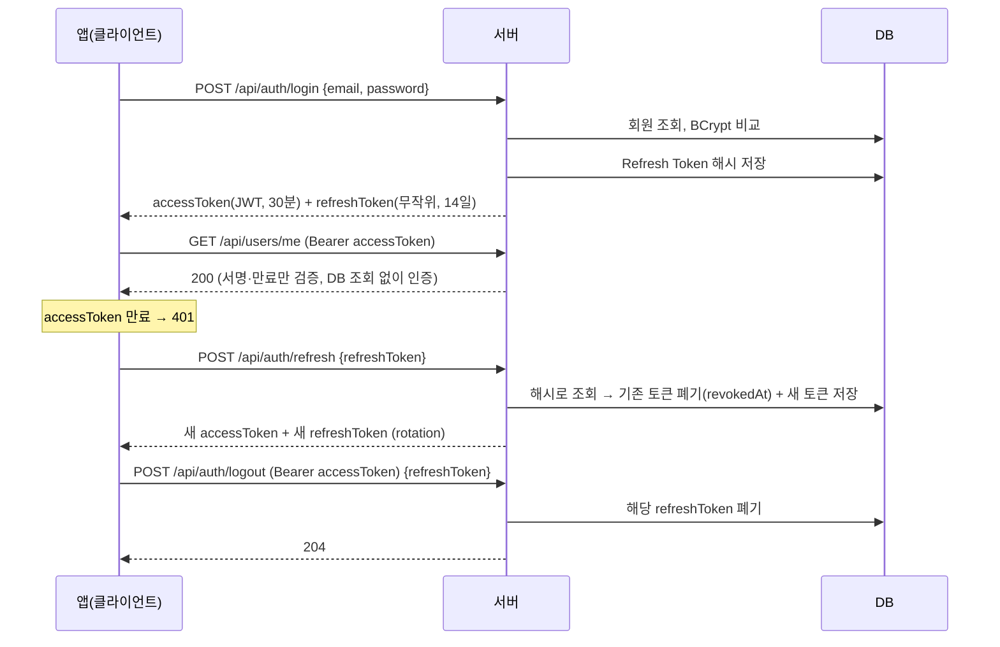

# kotoba

일본어 학습 앱 모노레포.

```
kotoba/
├── backend/   Spring Boot API 서버
├── app/       Flutter 앱 (추가 예정)
└── README.md
```

## 현재 상태

- 1단계: 백엔드 뼈대 (헬스체크, 프로필 분리)
- 2단계: 회원가입, JWT 로그인 (Access/Refresh Token)

도메인 기능(카드/덱 등)과 AI 연동은 아직 없습니다.

## 기술 스택 (backend)

- Java 21 (LTS), Spring Boot 4.1.x, Gradle (Wrapper 포함)
- Spring Web MVC, Validation, Data JPA, Actuator, Spring Security
- JWT: jjwt 0.13 (`jjwt-gson`. Boot 4가 Jackson 3를 쓰므로 Jackson 2를 끌어오는 `jjwt-jackson` 대신 사용)
- DB: 개발/테스트 H2 (PostgreSQL 호환 모드), 운영 PostgreSQL

## 패키지 구조

```
com.kotoba.backend
├── controller   HTTP 요청/응답 (REST API), controller/dto 에 요청·응답 DTO
├── service      비즈니스 로직, 트랜잭션 경계
├── repository   Spring Data JPA 리포지토리
├── domain       엔티티 (Member, RefreshToken)
├── security     JWT 발급·검증, 인증 필터, 401/403 응답
├── config       SecurityFilterChain, PasswordEncoder, Clock
└── exception    ErrorCode, 전역 예외 처리
```

## API

| 메서드 | 경로 | 인증 | 설명 | 성공 응답 |
|---|---|---|---|---|
| GET | `/api/health` | 불필요 | 헬스체크 | 200 `{"status":"UP"}` |
| POST | `/api/auth/signup` | 불필요 | 회원가입 `{email, password}` | 201 회원 정보 |
| POST | `/api/auth/login` | 불필요 | 로그인 `{email, password}` | 200 토큰 쌍 |
| POST | `/api/auth/refresh` | 불필요 | 토큰 재발급 `{refreshToken}` | 200 새 토큰 쌍 |
| POST | `/api/auth/logout` | **필요** | Refresh Token 폐기 `{refreshToken}` | 204 |
| GET | `/api/users/me` | **필요** | 내 정보 | 200 회원 정보 |

인증이 필요한 요청은 `Authorization: Bearer <accessToken>` 헤더를 붙입니다.

**입력 규칙**: 이메일 형식, 255자 이하(대소문자 구분 없이 중복 체크) / 비밀번호 8~72자

**토큰 응답 예시**
```json
{
  "tokenType": "Bearer",
  "accessToken": "eyJhbGciOiJIUzI1NiJ9...",
  "accessTokenExpiresIn": 1800,
  "refreshToken": "q3Jt...무작위 문자열",
  "refreshTokenExpiresIn": 1209600
}
```

**에러 응답 형식** (모든 에러 공통)
```json
{ "status": 400, "code": "INVALID_INPUT", "message": "요청 값이 올바르지 않습니다.",
  "errors": [ { "field": "email", "message": "이메일 형식이 올바르지 않습니다." } ] }
```

| code | HTTP | 상황 |
|---|---|---|
| `INVALID_INPUT` | 400 | Validation 실패 (`errors`에 필드별 사유) |
| `MALFORMED_REQUEST` | 400 | JSON 파싱 실패 |
| `UNAUTHORIZED` | 401 | Access Token 없음/만료/위조 |
| `INVALID_CREDENTIALS` | 401 | 이메일 또는 비밀번호 불일치 (어느 쪽인지 알려주지 않음) |
| `INVALID_REFRESH_TOKEN` | 401 | Refresh Token 없음/만료/폐기/재사용 (사유를 구분하지 않음) |
| `EMAIL_ALREADY_EXISTS` | 409 | 이미 가입된 이메일 |

## 인증 흐름



1. **로그인**: Access Token(JWT, 30분)과 Refresh Token(256비트 무작위 문자열, 14일)을 발급합니다.
   - Access Token에는 회원 id와 role만 들어갑니다. JWT 본문은 누구나 디코딩할 수 있어서 이메일 같은 정보는 넣지 않습니다.
   - Refresh Token은 DB에 **SHA-256 해시로만** 저장합니다. DB가 유출돼도 원문을 알 수 없습니다.
2. **API 호출**: 매 요청 `Authorization` 헤더의 Access Token을 `JwtAuthenticationFilter`가 검증합니다. 세션은 쓰지 않습니다(stateless).
3. **재발급(rotation)**: Access Token이 만료되면 Refresh Token으로 새 토큰 쌍을 받습니다. 쓴 Refresh Token은 즉시 폐기되므로 **한 번만** 쓸 수 있습니다.
   - 이미 폐기된 Refresh Token이 다시 들어오면 탈취로 보고, 그 회원의 **모든** Refresh Token을 폐기합니다. 정상 사용자도 다시 로그인해야 합니다.
4. **로그아웃**: 해당 Refresh Token을 폐기합니다. Access Token은 서버에 상태가 없어서 남은 수명(최대 30분) 동안은 유효합니다. 그래서 Access Token 수명을 짧게 둡니다.

**클라이언트(Flutter) 메모**: 두 토큰은 `flutter_secure_storage` 같은 보안 저장소에 둡니다. 401(`UNAUTHORIZED`)을 받으면 refresh를 한 번 시도합니다. refresh도 401이면 로그인 화면으로 보냅니다. 동시에 여러 요청이 refresh를 시도하면 재사용으로 감지되므로, refresh는 한 번만 실행되도록 직렬화해야 합니다.

### JWT 설정

| 설정 | 값 | 비고 |
|---|---|---|
| `JWT_SECRET` (환경변수) | 32바이트 이상 | **prod 필수.** 없거나 짧으면 앱이 기동되지 않습니다. dev 프로필에만 개발용 기본값이 있습니다. |
| `jwt.access-token-ttl` | `30m` | `application.yml` |
| `jwt.refresh-token-ttl` | `14d` | `application.yml` |

비밀 키 생성 예: `openssl rand -base64 48`

## 실행 방법

필요: JDK 21. Gradle은 Wrapper(`gradlew`)가 자동으로 받아옵니다.

```powershell
cd backend

# 테스트
.\gradlew.bat test

# 개발 서버 실행 (기본 프로필 dev = H2 인메모리)
.\gradlew.bat bootRun
```

macOS/Linux에서는 `./gradlew`를 사용합니다.

실행 후 확인:

| URL | 설명 |
|---|---|
| http://localhost:8080/api/health | 앱 헬스체크 → `{"status":"UP"}` |
| http://localhost:8080/actuator/health | Actuator 헬스체크 (DB 상태 포함) |
| http://localhost:8080/h2-console | H2 콘솔 (dev 전용). JDBC URL: `jdbc:h2:mem:kotoba`, 사용자 `sa`, 비밀번호 없음 |

## 프로필

| 프로필 | DB | 설정 파일 |
|---|---|---|
| `dev` (기본) | H2 인메모리, `MODE=PostgreSQL` | `application-dev.yml` |
| `prod` | PostgreSQL (환경변수로 접속) | `application-prod.yml` |

`prod` 실행에 필요한 환경변수는 [`backend/.env.example`](backend/.env.example)을 참고하세요.

```powershell
$env:SPRING_PROFILES_ACTIVE="prod"
$env:DB_URL="jdbc:postgresql://<host>:5432/kotoba"
$env:DB_USERNAME="..."
$env:DB_PASSWORD="..."
$env:JWT_SECRET="..."   # 32바이트 이상, 없으면 기동 실패
.\gradlew.bat bootRun
```

> 아직 실제 PostgreSQL에는 연결하지 않았습니다.

## 메모: PostgreSQL 전환 시 확인할 항목

H2의 PostgreSQL 호환 모드는 완전한 호환이 아닙니다. 실제 PostgreSQL로 옮길 때 아래를 확인합니다.

- [ ] **스키마 관리 도구 도입**: prod는 `ddl-auto: validate`라서 테이블을 직접 만들지 않습니다. Flyway 등으로 마이그레이션 스크립트를 관리해야 합니다.
- [ ] **ID 생성 전략**: `GenerationType.IDENTITY`와 `SEQUENCE`의 동작이 H2와 다를 수 있습니다. 시퀀스 이름과 증가값을 확인합니다.
- [ ] **PostgreSQL 전용 타입**: `jsonb`, 배열, `text`, `timestamptz`, enum 타입은 H2에서 다르게 동작하거나 지원되지 않습니다.
- [ ] **대소문자/예약어**: dev는 `DATABASE_TO_LOWER=TRUE`로 소문자 식별자를 쓰도록 맞췄습니다. `user`, `order` 같은 예약어를 테이블명으로 쓰지 않습니다.
- [ ] **문자열 비교/정렬**: PostgreSQL의 대소문자 구분, collation, `ILIKE`, 일본어 정렬 결과를 실제 DB에서 확인합니다.
- [ ] **네이티브 쿼리**: `@Query(nativeQuery = true)`는 PostgreSQL에서 다시 테스트합니다.
- [ ] **테스트 DB**: 가능하면 통합 테스트를 실제 PostgreSQL(예: Testcontainers, Docker 필요)로도 돌리는 방안을 검토합니다.
- [ ] **커넥션 풀 설정**: HikariCP `maximum-pool-size`, 타임아웃 값을 운영 환경에 맞게 조정합니다.
- [ ] **시간 컬럼 타입**: `Instant` 필드(`created_at`, `expires_at`, `revoked_at`)가 `timestamptz`로 매핑되는지 확인합니다.
- [ ] **refresh_tokens 정리**: 폐기·만료된 토큰이 계속 쌓이므로, 주기적으로 삭제하는 배치를 둡니다.
