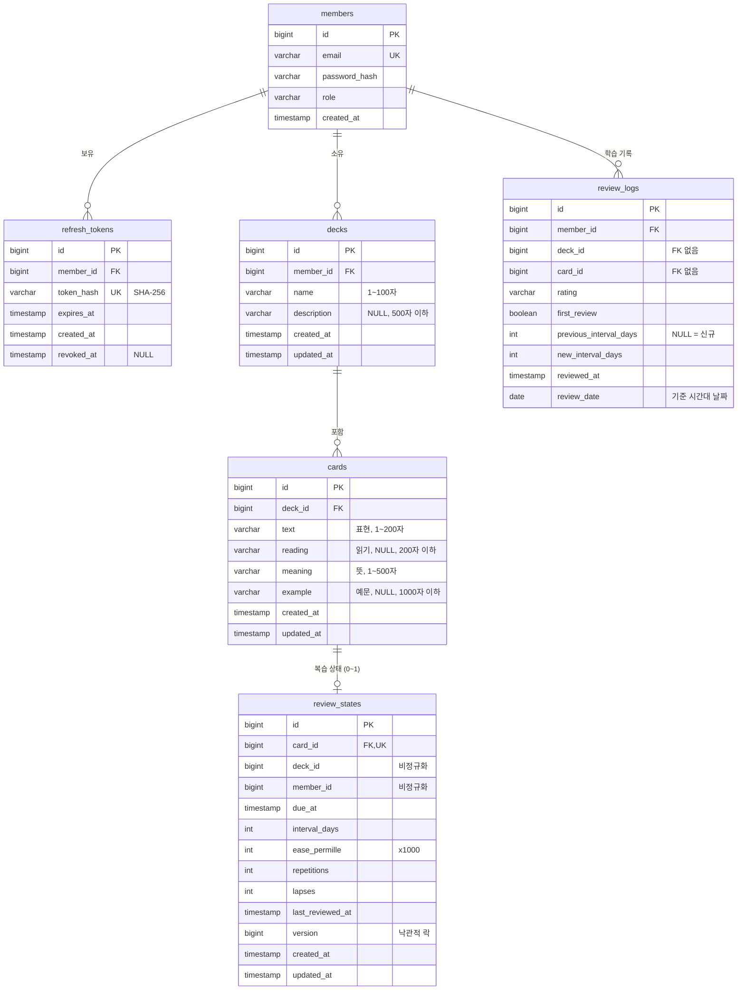
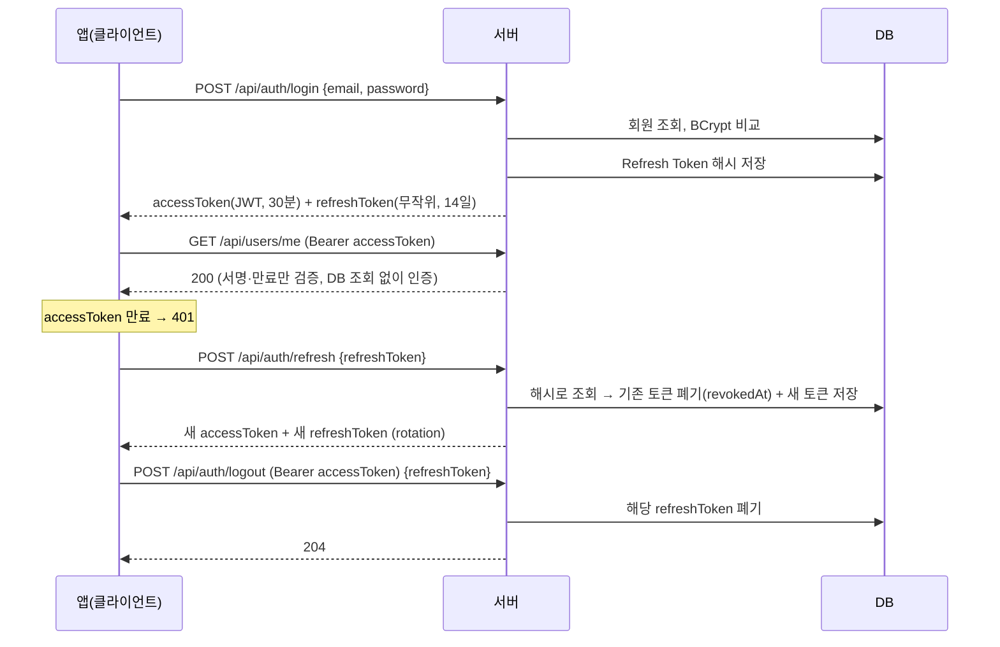

# kotoba

[](https://github.com/monenon-dev/kotoba/actions/workflows/ci.yml)

일본어 학습 앱 모노레포.

```
kotoba/
├── .github/workflows/  CI (GitHub Actions)
├── backend/            Spring Boot API 서버
├── app/                Flutter 앱 (추가 예정)
├── docs/               설계 문서
└── README.md
```

## 현재 상태

- 1단계: 백엔드 뼈대 (헬스체크, 프로필 분리)
- 2단계: 회원가입, JWT 로그인 (Access/Refresh Token)
- 3단계: 덱/카드 CRUD, 소유자 권한 ([설계 문서](docs/design/03-deck-card.md))
- 4단계: 복습(SRS), 학습 기록, 통계 ([설계 문서](docs/design/04-srs-stats.md))
- 5단계: GitHub Actions CI, PostgreSQL 전환(Flyway) ([설계 문서](docs/design/05-ci-postgres.md))

AI 연동은 아직 없습니다.

## 설계 문서

| 문서 | 내용 |
|---|---|
| [docs/design/03-deck-card.md](docs/design/03-deck-card.md) | 덱/카드 ERD, 연관관계 방향, 403 대신 404, 삭제 방식, 페이지네이션, N+1 방지 |
| [docs/design/04-srs-stats.md](docs/design/04-srs-stats.md) | 복습 알고리즘 수식, 날짜 경계(시간대), 신규 카드 한도, 연속 학습일, 낙관적 락, 통계 집계와 인덱스 |
| [docs/design/05-ci-postgres.md](docs/design/05-ci-postgres.md) | CI 워크플로 구조, H2와 PostgreSQL 역할 분담과 한계, Flyway 규칙, 스키마 일치 검사, flaky 평가 |

## ERD



- 연관관계는 모두 단방향입니다(컬렉션 없음).
- 카드의 소유자는 `cards → decks → members`로 판단합니다.
- 덱을 삭제하면 서비스가 같은 트랜잭션에서 복습 상태 → 카드 → 덱 순서로 일괄 삭제합니다. 외래키는 `ON DELETE CASCADE` 없이 기본 동작입니다.
- 카드·덱을 지워도 **리뷰 로그는 남깁니다.** 연속 학습일과 지난 통계를 유지하기 위해서입니다.
- 인덱스는 다음과 같습니다.
  - `review_states`: `UNIQUE(card_id)`, `(deck_id, due_at)`, `(member_id, due_at)`
  - `review_logs`: `(member_id, review_date)`
- 자세한 이유는 설계 문서([03](docs/design/03-deck-card.md), [04](docs/design/04-srs-stats.md))를 참고하세요.

## 기술 스택 (backend)

- Java 21 (LTS), Spring Boot 4.1.x, Gradle (Wrapper 포함)
- Spring Web MVC, Validation, Data JPA, Actuator, Spring Security
- JWT: jjwt 0.13 (`jjwt-gson`. Boot 4가 Jackson 3를 쓰므로 Jackson 2를 끌어오는 `jjwt-jackson` 대신 사용)
- DB: 개발/테스트 H2 (PostgreSQL 호환 모드), 운영 PostgreSQL

## 패키지 구조

```
com.kotoba.backend
├── controller   HTTP 요청/응답 (REST API), controller/dto 에 요청·응답 DTO
├── service      비즈니스 로직, 트랜잭션 경계
├── repository   Spring Data JPA 리포지토리
├── domain       엔티티 (Member, RefreshToken, Deck, Card, ReviewState, ReviewLog)
├── srs          복습 알고리즘 SrsScheduler (Spring 의존 없는 순수 클래스)
├── security     JWT 발급·검증, 인증 필터, 401/403 응답
├── config       SecurityFilterChain, PasswordEncoder, Clock, StudyProperties
└── exception    ErrorCode, 전역 예외 처리
```

## API

| 메서드 | 경로 | 인증 | 설명 | 성공 응답 |
|---|---|---|---|---|
| GET | `/api/health` | 불필요 | 헬스체크 | 200 `{"status":"UP"}` |
| POST | `/api/auth/signup` | 불필요 | 회원가입 `{email, password}` | 201 회원 정보 |
| POST | `/api/auth/login` | 불필요 | 로그인 `{email, password}` | 200 토큰 쌍 |
| POST | `/api/auth/refresh` | 불필요 | 토큰 재발급 `{refreshToken}` | 200 새 토큰 쌍 |
| POST | `/api/auth/logout` | **필요** | Refresh Token 폐기 `{refreshToken}` | 204 |
| GET | `/api/users/me` | **필요** | 내 정보 | 200 회원 정보 |
| POST | `/api/decks` | **필요** | 덱 생성 `{name, description?}` | 201 덱 |
| GET | `/api/decks?page=&size=` | **필요** | 내 덱 목록 (최신순, `cardCount` 포함) | 200 페이지 |
| GET | `/api/decks/{deckId}` | **필요** | 덱 조회 | 200 덱 |
| PUT | `/api/decks/{deckId}` | **필요** | 덱 수정 (전체 교체) | 200 덱 |
| DELETE | `/api/decks/{deckId}` | **필요** | 덱 삭제 (속한 카드도 삭제) | 204 |
| POST | `/api/decks/{deckId}/cards` | **필요** | 카드 생성 `{text, reading?, meaning, example?}` | 201 카드 |
| GET | `/api/decks/{deckId}/cards?page=&size=` | **필요** | 카드 목록 (추가한 순) | 200 페이지 |
| GET | `/api/decks/{deckId}/cards/{cardId}` | **필요** | 카드 조회 | 200 카드 |
| PUT | `/api/decks/{deckId}/cards/{cardId}` | **필요** | 카드 수정 (전체 교체) | 200 카드 |
| DELETE | `/api/decks/{deckId}/cards/{cardId}` | **필요** | 카드 삭제 (복습 상태도 삭제, 로그는 보존) | 204 |
| GET | `/api/decks/{deckId}/study/due?limit=` | **필요** | 지금 복습할 카드 (기한 지난 카드 + 신규 한도 내 새 카드) | 200 |
| POST | `/api/decks/{deckId}/cards/{cardId}/reviews` | **필요** | 복습 평가 `{rating}` → 상태 갱신 + 로그 저장 | 200 다음 복습 시각 |
| GET | `/api/stats/summary` | **필요** | 오늘 복습 수, 기한 지난 카드 수, 연속 학습일, 최근 7일 정답률 | 200 |
| GET | `/api/stats/daily?from=&to=` | **필요** | 날짜별 복습 수 (최대 90일) | 200 |

인증이 필요한 요청은 `Authorization: Bearer <accessToken>` 헤더를 붙입니다.

**덱/카드 규칙**
- **소유자 권한:** 본인의 덱과 카드만 접근할 수 있습니다. 남의 덱·카드나 없는 id는 403이 아니라 똑같이 404(`DECK_NOT_FOUND` / `CARD_NOT_FOUND`)입니다. 존재 여부를 드러내지 않기 위해서입니다. 카드가 URL의 덱에 속하지 않아도 404입니다.
- **PUT은 전체 교체:** 선택 필드(`description`, `reading`, `example`)를 생략하면 `null`이 됩니다.
- **페이지네이션:** `page`는 0부터 시작하고, `size`는 기본 20, **최대 100**입니다. 더 크게 요청하면 100으로 잘립니다. 정렬은 서버가 고정하며 `sort` 파라미터는 무시합니다.
- **입력 규칙:** 덱 이름 1~100자, 설명 ≤500 / 카드 표현 1~200, 읽기 ≤200, 뜻 1~500, 예문 ≤1000

**페이지 응답 형식**
```json
{ "content": [ ... ], "page": 0, "size": 20, "totalElements": 42, "totalPages": 3, "hasNext": true }
```

**덱 응답 예시**
```json
{ "id": 1, "name": "JLPT N3", "description": "N3 단어", "cardCount": 120,
  "createdAt": "2026-11-04T12:00:00Z", "updatedAt": "2026-11-04T12:00:00Z" }
```

**카드 응답 예시**
```json
{ "id": 10, "deckId": 1, "text": "勉強", "reading": "べんきょう", "meaning": "공부",
  "example": "毎日勉強します。", "createdAt": "2026-11-04T12:00:00Z", "updatedAt": "2026-11-04T12:00:00Z" }
```

**입력 규칙**: 이메일 형식, 255자 이하(대소문자 구분 없이 중복 체크) / 비밀번호 8~72자

**토큰 응답 예시**
```json
{
  "tokenType": "Bearer",
  "accessToken": "eyJhbGciOiJIUzI1NiJ9...",
  "accessTokenExpiresIn": 1800,
  "refreshToken": "q3Jt...무작위 문자열",
  "refreshTokenExpiresIn": 1209600
}
```

**에러 응답 형식** (모든 에러 공통)
```json
{ "status": 400, "code": "INVALID_INPUT", "message": "요청 값이 올바르지 않습니다.",
  "errors": [ { "field": "email", "message": "이메일 형식이 올바르지 않습니다." } ] }
```

| code | HTTP | 상황 |
|---|---|---|
| `INVALID_INPUT` | 400 | Validation 실패, 숫자가 아닌 id 등 (`errors`에 필드별 사유) |
| `MALFORMED_REQUEST` | 400 | JSON 파싱 실패 |
| `UNAUTHORIZED` | 401 | Access Token 없음/만료/위조 |
| `INVALID_CREDENTIALS` | 401 | 이메일 또는 비밀번호 불일치 (어느 쪽인지 알려주지 않음) |
| `INVALID_REFRESH_TOKEN` | 401 | Refresh Token 없음/만료/폐기/재사용 (사유를 구분하지 않음) |
| `DECK_NOT_FOUND` | 404 | 덱이 없거나 내 덱이 아님 |
| `CARD_NOT_FOUND` | 404 | 카드가 없거나, 내 카드가 아니거나, URL의 덱에 속하지 않음 |
| `EMAIL_ALREADY_EXISTS` | 409 | 이미 가입된 이메일 |
| `REVIEW_CONFLICT` | 409 | 같은 카드의 복습이 동시에 처리됨 (목록을 새로 받아 다시 시도) |

## 복습(SRS)과 통계

### 알고리즘 요약 (SM-2 단순화)

카드마다 연속 성공 횟수 n, 간격 I(일), 난이도 계수 EF(초기 2.5, 하한 1.3)를 가집니다. 복습 후 평가에 따라 다음처럼 바뀝니다.

| 평가 | 간격 | EF |
|---|---|---|
| AGAIN | 0, **10분 뒤** 다시 (n = 0, 실패 + 1) | −0.20 |
| HARD | 첫 복습 1일, 이후 `I × 1.2` (GOOD 이하) | −0.15 |
| GOOD | 1일 → `max(3, I + 1)` → `max(I + 1, I × EF)` | 그대로 |
| EASY | 첫 복습 4일, 이후 `max(GOOD + 1, I × EF × 1.3)` | +0.15 |

- **간격 상한과 순서:** 간격은 최대 365일입니다. n ≥ 1이면 `HARD ≤ GOOD < EASY`가 항상 지켜집니다.
- **다음 복습 시각:** 간격이 1일 이상이면 기준 시간대의 **(오늘 + I)일 자정**입니다.
- **예시:** 신규 카드에 계속 GOOD을 누르면 간격은 1 → 3 → 8 → 20일입니다.
- **구현:** `SrsScheduler`는 Spring 없이 `Clock`과 시간대만 주입받는 순수 클래스입니다.

### 규칙
- **기준 시간대:** `app.study.zone`이고 기본값은 `Asia/Seoul`입니다. "오늘", 연속 학습일, 날짜별 통계가 모두 이 시간대의 자정을 경계로 합니다.
- **신규 카드:** 복습 상태가 없는 카드입니다. 하루 한도는 `app.study.daily-new-card-limit`(기본 20)이고, 회원 단위로 모든 덱을 합산합니다.
  - 오늘 시작한 수는 `review_logs`에서 `review_date = 오늘 AND first_review = TRUE`인 개수입니다.
  - 한도는 due 목록을 만들 때만 적용하고, 복습 API는 막지 않습니다.
- **due 목록:** 기한 지난 카드(`due_at` 오름차순)를 먼저 넣고, 남은 자리를 신규 카드(추가한 순)로 채웁니다. `limit`은 기본 20, 최대 100이고, 1 미만이면 400입니다.
- **연속 학습일:** 오늘 복습했으면 오늘부터 셉니다. 아직 안 했으면 어제부터 거꾸로 셉니다. 오늘이 끝날 때까지는 끊기지 않고, 하루를 건너뛰면 0입니다. 최근 366일만 조회하므로 최대 366입니다.
- **정답률:** 최근 7일(오늘 포함) 동안 AGAIN이 아닌 비율입니다. 복습이 없으면 `null`입니다.
- **동시 복습:** 같은 카드의 복습이 동시에 오면 `@Version`(또는 첫 복습이면 `UNIQUE(card_id)`)으로 하나만 반영하고, 나머지는 409로 응답합니다.
- **통계 쿼리:** 모두 DB 집계(`COUNT`, `SUM(CASE)`, `GROUP BY review_date`)입니다. summary는 쿼리 4개, daily는 1개로 데이터 양과 무관합니다.

**복습 응답 예시**
```json
{ "cardId": 10, "rating": "GOOD", "reviewedAt": "2026-11-04T01:00:00Z",
  "previousIntervalDays": 3, "intervalDays": 8, "easeFactor": 2.5,
  "repetitions": 3, "lapses": 0, "dueAt": "2026-11-11T15:00:00Z" }
```

**summary 응답 예시**
```json
{ "today": "2026-11-04", "timeZone": "Asia/Seoul", "todayReviews": 12, "dueCards": 5, "streakDays": 7,
  "last7Days": { "from": "2026-10-29", "to": "2026-11-04", "reviews": 80, "correct": 68, "accuracy": 0.85 } }
```

**daily 응답 예시** (`?from=2026-11-01&to=2026-11-03`, 기록이 없는 날은 0)
```json
{ "from": "2026-11-01", "to": "2026-11-03", "timeZone": "Asia/Seoul",
  "days": [ { "date": "2026-11-01", "reviews": 20 }, { "date": "2026-11-02", "reviews": 0 }, { "date": "2026-11-03", "reviews": 15 } ] }
```

## 인증 흐름



1. **로그인**: Access Token(JWT, 30분)과 Refresh Token(256비트 무작위 문자열, 14일)을 발급합니다.
   - Access Token에는 회원 id와 role만 들어갑니다. JWT 본문은 누구나 디코딩할 수 있어서 이메일 같은 정보는 넣지 않습니다.
   - Refresh Token은 DB에 **SHA-256 해시로만** 저장합니다. DB가 유출돼도 원문을 알 수 없습니다.
2. **API 호출**: 매 요청 `Authorization` 헤더의 Access Token을 `JwtAuthenticationFilter`가 검증합니다. 세션은 쓰지 않습니다(stateless).
3. **재발급(rotation)**: Access Token이 만료되면 Refresh Token으로 새 토큰 쌍을 받습니다. 쓴 Refresh Token은 즉시 폐기되므로 **한 번만** 쓸 수 있습니다.
   - 이미 폐기된 Refresh Token이 다시 들어오면 탈취로 보고, 그 회원의 **모든** Refresh Token을 폐기합니다. 정상 사용자도 다시 로그인해야 합니다.
4. **로그아웃**: 해당 Refresh Token을 폐기합니다. Access Token은 서버에 상태가 없어서 남은 수명(최대 30분) 동안은 유효합니다. 그래서 Access Token 수명을 짧게 둡니다.

**클라이언트(Flutter) 메모**: 두 토큰은 `flutter_secure_storage` 같은 보안 저장소에 둡니다. 401(`UNAUTHORIZED`)을 받으면 refresh를 한 번 시도합니다. refresh도 401이면 로그인 화면으로 보냅니다. 동시에 여러 요청이 refresh를 시도하면 재사용으로 감지되므로, refresh는 한 번만 실행되도록 직렬화해야 합니다.

### JWT 설정

| 설정 | 값 | 비고 |
|---|---|---|
| `JWT_SECRET` (환경변수) | 32바이트 이상 | **prod 필수.** 없거나 짧으면 앱이 기동되지 않습니다. dev 프로필에만 개발용 기본값이 있습니다. |
| `jwt.access-token-ttl` | `30m` | `application.yml` |
| `jwt.refresh-token-ttl` | `14d` | `application.yml` |

비밀 키 생성 예: `openssl rand -base64 48`

## 실행 방법

필요: JDK 21. Gradle은 Wrapper(`gradlew`)가 자동으로 받아옵니다.

```powershell
cd backend

# 테스트
.\gradlew.bat test

# 개발 서버 실행 (기본 프로필 dev = H2 인메모리)
.\gradlew.bat bootRun
```

macOS/Linux에서는 `./gradlew`를 사용합니다.

실행 후 확인:

| URL | 설명 |
|---|---|
| http://localhost:8080/api/health | 앱 헬스체크 → `{"status":"UP"}` |
| http://localhost:8080/actuator/health | Actuator 헬스체크 (DB 상태 포함) |
| http://localhost:8080/h2-console | H2 콘솔 (dev 전용). JDBC URL: `jdbc:h2:mem:kotoba`, 사용자 `sa`, 비밀번호 없음 |

## 프로필

| 프로필 | DB | 스키마 | 설정 파일 |
|---|---|---|---|
| `dev` (기본) | H2 인메모리, `MODE=PostgreSQL` | Hibernate `create-drop` (Flyway 끔) | `application-dev.yml` |
| `prod` | PostgreSQL (환경변수로 접속) | **Flyway** + Hibernate `validate` | `application-prod.yml` |
| `pgtest` (테스트 전용) | PostgreSQL (CI 서비스 컨테이너) | **Flyway** + Hibernate `validate` | `src/test/resources/application-pgtest.yml` |

## CI와 DB 마이그레이션

**CI (GitHub Actions, `.github/workflows/ci.yml`)**

push와 PR마다 두 작업이 병렬로 돕니다.

| 작업 | DB | 하는 일 |
|---|---|---|
| `h2` | H2 | `./gradlew build` (빌드 + 전체 테스트). 로컬과 같은 조건 |
| `postgres` | PostgreSQL 17 서비스 컨테이너 | `TEST_DB=postgres`로 **같은 테스트 전체**를 `pgtest` 프로필로 실행 + `SchemaConsistencyTest` |

- **권한:** `contents: read`만 줍니다.
- **비밀값:** `secrets`를 쓰지 않습니다. DB 비밀번호와 `JWT_SECRET`은 CI 전용 가짜 값입니다.
- **결과물:** 테스트 리포트는 Actions 실행 화면의 Artifacts(`test-reports-h2`, `test-reports-postgres`)에서 7일간 받을 수 있습니다.
- **로컬:** 로컬에는 Docker가 없어서 `.\gradlew.bat test`는 H2로만 돕니다. PostgreSQL 검증은 CI가 맡습니다.

**엔티티와 스키마 일치 검사 (PostgreSQL 작업)**
1. **Hibernate `ddl-auto: validate`:** 테이블, 컬럼, 타입을 검사합니다. 어긋나면 컨텍스트 기동이 실패해서 모든 테스트가 실패합니다.
2. **`SchemaConsistencyTest`:** `validate`가 보지 않는 **인덱스, UNIQUE, FK, NOT NULL, varchar 길이**를 검사합니다. 엔티티 어노테이션과 PostgreSQL 카탈로그를 비교하며, 의도적으로 FK가 없는 컬럼에 FK가 생겨도 실패합니다.

**Flyway 마이그레이션 규칙** (`backend/src/main/resources/db/migration`)
1. 적용된(main에 머지된) 파일은 **수정하지 않습니다.** 변경은 새 파일 `V{번호}__{설명}.sql`로 합니다.
2. 엔티티를 바꾸는 PR에는 마이그레이션도 함께 넣습니다. 빠뜨리면 CI `postgres` 작업이 실패합니다.
3. PostgreSQL 문법으로 씁니다. H2에서는 실행하지 않습니다.
4. 되돌리기도 새 마이그레이션으로 합니다. 운영에서 `flyway clean`은 금지입니다(Spring Boot 기본값).

자세한 내용은 [설계 문서](docs/design/05-ci-postgres.md)를 참고하세요.

`prod` 실행에 필요한 환경변수는 [`backend/.env.example`](backend/.env.example)을 참고하세요.

```powershell
$env:SPRING_PROFILES_ACTIVE="prod"
$env:DB_URL="jdbc:postgresql://<host>:5432/kotoba"
$env:DB_USERNAME="..."
$env:DB_PASSWORD="..."
$env:JWT_SECRET="..."   # 32바이트 이상, 없으면 기동 실패
.\gradlew.bat bootRun
```

> 운영 PostgreSQL은 아직 없습니다. 같은 설정(Flyway + validate)을 CI의 PostgreSQL 서비스 컨테이너에서 매번 검증합니다.

## 메모: PostgreSQL 전환 시 확인할 항목

H2의 PostgreSQL 호환 모드는 완전한 호환이 아닙니다. 실제 PostgreSQL로 옮길 때 아래를 확인합니다.

- [ ] **스키마 관리 도구 도입**: prod는 `ddl-auto: validate`라서 테이블을 직접 만들지 않습니다. Flyway 등으로 마이그레이션 스크립트를 관리해야 합니다.
- [ ] **ID 생성 전략**: `GenerationType.IDENTITY`와 `SEQUENCE`의 동작이 H2와 다를 수 있습니다. 시퀀스 이름과 증가값을 확인합니다.
- [ ] **PostgreSQL 전용 타입**: `jsonb`, 배열, `text`, `timestamptz`, enum 타입은 H2에서 다르게 동작하거나 지원되지 않습니다.
- [ ] **대소문자/예약어**: dev는 `DATABASE_TO_LOWER=TRUE`로 소문자 식별자를 쓰도록 맞췄습니다. `user`, `order` 같은 예약어를 테이블명으로 쓰지 않습니다.
- [ ] **문자열 비교/정렬**: PostgreSQL의 대소문자 구분, collation, `ILIKE`, 일본어 정렬 결과를 실제 DB에서 확인합니다.
- [ ] **네이티브 쿼리**: `@Query(nativeQuery = true)`는 PostgreSQL에서 다시 테스트합니다.
- [ ] **테스트 DB**: 가능하면 통합 테스트를 실제 PostgreSQL(예: Testcontainers, Docker 필요)로도 돌리는 방안을 검토합니다.
- [ ] **커넥션 풀 설정**: HikariCP `maximum-pool-size`, 타임아웃 값을 운영 환경에 맞게 조정합니다.
- [ ] **시간 컬럼 타입**: `Instant` 필드(`created_at`, `expires_at`, `revoked_at`)가 `timestamptz`로 매핑되는지 확인합니다.
- [ ] **refresh_tokens 정리**: 폐기·만료된 토큰이 계속 쌓이므로, 주기적으로 삭제하는 배치를 둡니다.
- [ ] **날짜 계산 위치**: 통계는 DB의 날짜·시간대 함수를 쓰지 않습니다. Java에서 계산해 저장한 `review_logs.review_date`(DATE)로만 비교하고 `GROUP BY` 합니다. 앞으로 쿼리를 추가할 때도 `AT TIME ZONE`, `DATE_TRUNC`, `CAST(... AS DATE)` 같은 DB별 함수 대신 이 방식을 유지합니다.
- [ ] **DB 세션 시간대**: `reviewed_at`, `due_at` 같은 `Instant` 컬럼이 PostgreSQL에서 `timestamptz`로 생성되고 UTC로 저장되는지 확인합니다. 필요하면 `hibernate.jdbc.time_zone=UTC`를 설정합니다.
- [ ] **boolean / enum 컬럼**: `first_review`는 PostgreSQL `boolean`으로, `rating`은 `varchar`로 매핑되는지 확인합니다. 마이그레이션 스크립트에서 PostgreSQL enum 타입을 쓰지 않는 것을 권장합니다.
- [ ] **낙관적 락과 격리 수준**: PostgreSQL 기본(READ COMMITTED)에서 `UPDATE ... WHERE version = ?`가 동시 갱신 시 0행이 되어 409로 이어지는지 확인합니다. `parallelReviewsNeverLoseUpdates` 테스트를 PostgreSQL(Testcontainers)로도 돌립니다.
- [ ] **UNIQUE 위반 예외**: 첫 복습 동시 요청에서 `uk_review_states_card_id` 위반이 `DataIntegrityViolationException`으로 변환되어 409가 되는지 확인합니다.
- [ ] **인덱스**: 마이그레이션에 `review_states(deck_id, due_at)`, `(member_id, due_at)`, `UNIQUE(card_id)`, `review_logs(member_id, review_date)`를 포함하고, `EXPLAIN`으로 due 조회와 통계 쿼리가 인덱스를 타는지 확인합니다.
- [ ] **`NOT EXISTS` 신규 카드 조회**: 카드가 많은 덱에서 실행 계획(anti join)을 확인합니다.

## 알려진 제한과 개선 후보

| 항목 | 현재 동작 | 영향 | 개선 후보 |
|---|---|---|---|
| **날짜 경계가 자정** | 간격이 1일 이상인 카드는 기준 시간대의 자정부터 복습할 수 있음 | 밤 23:59에 GOOD(1일)을 누르면 **1분 뒤 자정에 다시 나옴**. 밤에 공부하는 사용자에게 어색함 | 하루 시작 시각을 **새벽 4시**처럼 설정할 수 있게 함 (Anki 방식). 날짜 계산을 `(시각 − 4시간)`의 날짜로 바꿈 |
| **시간대 변경** | `review_date`를 저장 시점의 시간대로 계산해 저장 | `app.study.zone`을 바꾸면 과거 로그의 날짜가 예전 시간대 기준으로 남음. 연속 학습일과 날짜별 통계가 어긋날 수 있음 | 시간대를 바꿀 때 `reviewed_at`으로 `review_date`를 **다시 계산하는 마이그레이션**을 실행. 회원별 시간대가 필요하면 `members.time_zone` 추가 |
| **회원 탈퇴 미구현** | 리뷰 로그에 `member_id`가 남고, 카드·덱 삭제와 무관하게 보존됨 | 탈퇴 기능을 만들 때 로그를 그대로 두면 개인 학습 기록이 남음 | 탈퇴 시 리뷰 로그를 **삭제하거나 익명화**(통계용 집계만 남기기). 복습 상태, 카드, 덱, 토큰 삭제 순서도 함께 설계 |
| **비정규화 컬럼** | `review_states.deck_id`, `member_id`는 카드의 소속에서 복사한 값 | 지금은 카드를 다른 덱으로 옮기는 API가 없어서 문제없음 | **카드 이동 API를 추가하면** 같은 트랜잭션에서 `review_states.deck_id`(다른 회원에게 옮긴다면 `member_id`도)를 함께 갱신해야 함 |
| 연속 학습일 최대 366 | 최근 366일만 조회 | 1년 넘게 연속 학습해도 366으로 표시 | 회원별 연속 기록을 따로 저장 |
| **Actions 버전 고정 방식** | 워크플로의 액션을 주 버전 태그(`actions/checkout@v7` 등)로 지정 | 태그가 가리키는 커밋이 바뀌면 검토하지 않은 코드가 CI에서 실행될 수 있음 (공급망 위험) | Actions를 **커밋 SHA로 고정**하고, Dependabot으로 버전 업데이트 PR을 받기 |
| **로컬 PostgreSQL 검증 없음** | 로컬에 Docker가 없어서 `gradlew test`는 H2로만 돎. 마이그레이션 오류는 push 후 CI에서만 잡힘 | 엔티티나 마이그레이션을 고칠 때 피드백이 느림 (push → CI 대기) | Docker를 쓸 수 있게 되면 **Testcontainers**로 로컬에서도 PostgreSQL 통합 테스트를 실행 (`TEST_DB=postgres`와 같은 경로를 재사용) |
