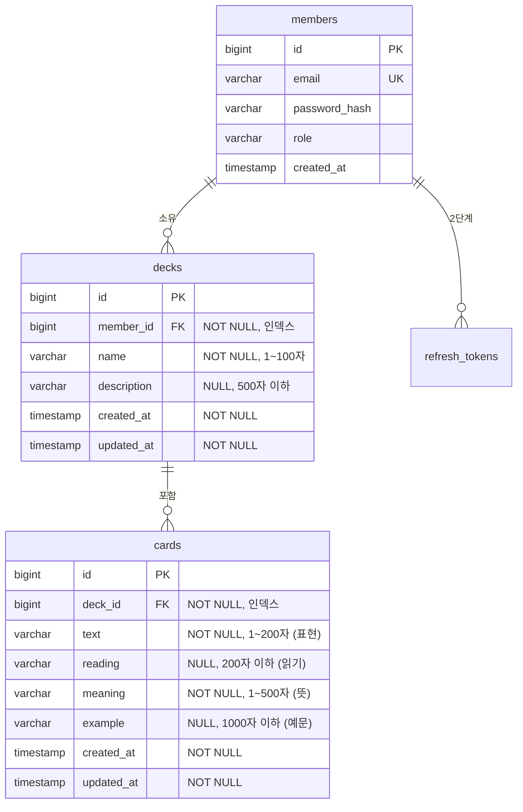

# 3단계 설계: 덱(Deck)과 카드(Card) CRUD

> 상태: **구현 완료** (2026-11-04). SRS 복습 로직과 통계는 이 단계 범위가 아닙니다.
> 검토 때 확정한 사항: 길이 제한은 제안값 그대로, PUT 은 전체 교체, 카드 변경 시 덱 `updatedAt` 은 갱신하지 않음.

## 1. ERD



| 테이블 | 제약 / 인덱스 | 이유 |
|---|---|---|
| `decks` | FK `member_id → members.id`, 인덱스 `idx_decks_member_id` | 목록 조회가 항상 `member_id` 조건이므로 |
| `cards` | FK `deck_id → decks.id`, 인덱스 `idx_cards_deck_id` | 카드 목록 조회와 덱별 카드 수 집계가 `deck_id` 기준이므로 |

- `cards`에는 `member_id`를 두지 않습니다. 소유자는 `cards → decks → members`로 판단합니다. 중복 컬럼을 두면 값이 서로 어긋날 수 있기 때문입니다.
- 길이 제한 숫자는 제안값입니다. 바꾸고 싶으면 알려주세요.

## 2. 엔티티 관계와 연관관계 방향

| 관계 | 매핑 | 방향 |
|---|---|---|
| Deck → Member | `@ManyToOne(fetch = LAZY, optional = false)` | **단방향** |
| Card → Deck | `@ManyToOne(fetch = LAZY, optional = false)` | **단방향** |

`Member.decks`나 `Deck.cards` 같은 컬렉션(`@OneToMany`)은 **두지 않습니다.**

이유:
- **조회는 항상 페이지 단위입니다.** 덱의 카드 수천 장을 컬렉션으로 한 번에 메모리에 올릴 일이 없습니다. 카드 목록은 리포지토리의 페이지 쿼리로 가져옵니다.
- **컬렉션은 N+1과 대량 로딩의 원인이 되기 쉽습니다.** `deck.getCards().size()` 같은 코드 한 줄이 덱마다 쿼리를 만듭니다. 컬렉션이 없으면 이런 코드를 실수로 쓸 수 없습니다.
- **양방향은 양쪽을 맞춰 줘야 하는 부담**(연관관계 편의 메서드)이 있습니다. 지금 요구사항에서는 얻는 게 없습니다.
- 나중에 필요해지면 그때 `@OneToMany(mappedBy = ...)`를 추가하면 됩니다. 스키마는 바뀌지 않습니다.

`LAZY`를 쓰는 이유: 카드를 조회할 때마다 덱과 회원까지 끌려오지 않게 하기 위해서입니다. 소유자 확인은 아래처럼 쿼리 조건으로 처리하므로, 연관 엔티티를 로딩할 필요가 없습니다.

## 3. 소유자 권한: 403 대신 404

모든 조회/수정/삭제는 **소유자 조건을 쿼리에 포함**합니다.

```
덱:   find deck where id = :deckId and member.id = :memberId
카드: find card where id = :cardId and deck.id = :deckId and deck.member.id = :memberId
```

- 결과가 없으면 "존재하지 않음"과 "남의 것"을 구분하지 않고 같은 404를 반환합니다.
  - 덱: `DECK_NOT_FOUND`
  - 카드: `CARD_NOT_FOUND`
- 먼저 조회한 뒤 소유자를 비교하는 방식(조회 → `if owner != me` → 403)은 쓰지 않습니다. 비교를 빠뜨리는 실수가 생길 수 있고, 403/404 차이로 존재 여부가 드러나기 때문입니다.
- 내 덱 A의 카드를 내 덱 B 경로(`/api/decks/B/cards/{A의 카드}`)로 요청해도 404입니다. URL의 덱과 카드가 실제로 연결되어 있어야 합니다.

## 4. 덱 삭제 시 카드 삭제 방식

| 방식 | 장점 | 단점 |
|---|---|---|
| JPA cascade (`@OneToMany(cascade = REMOVE)`) | 코드가 짧음 | 양방향 컬렉션이 필요함. 카드를 **전부 메모리에 올린 뒤 한 건씩 DELETE**함 (카드 N장 = 쿼리 N개) |
| DB 외래키 `ON DELETE CASCADE` | DB가 한 번에 처리해서 빠르고 원자적임 | 코드에 보이지 않음. 마이그레이션 DDL에 의존함 (prod는 `ddl-auto: validate`라서 Flyway 스크립트에 따로 써야 함). JPA 영속성 컨텍스트가 삭제 사실을 모름 |
| **서비스에서 직접 삭제 (선택)** | 코드에 명시적임. **쿼리 2개로 끝남** (카드 일괄 DELETE → 덱 DELETE). H2와 PostgreSQL에서 똑같이 동작함 | 삭제 순서를 서비스가 책임져야 함 |

**선택: 서비스에서 직접 일괄 삭제**

```
@Transactional
deleteDeck: 소유자 조건으로 덱 조회(없으면 404)
         → delete from Card c where c.deck.id = :deckId   (JPQL 벌크 1회)
         → delete deck
```

- **같은 트랜잭션입니다.** 중간에 실패하면 카드 삭제도 함께 롤백됩니다.
- **외래키 안전장치:** 외래키는 기본 동작(RESTRICT 계열)으로 둡니다. 카드가 남아 있는데 덱만 지워지는 고아 데이터는 DB가 거부합니다.
- **다음 단계 확장:** SRS 단계에서 복습 기록처럼 카드에 딸린 데이터가 생기면, 같은 자리에 삭제 단계를 한 줄 추가하면 됩니다. 그래서 확장하기도 쉽습니다.

### 벌크 DELETE 와 영속성 컨텍스트

JPQL 벌크 DELETE 는 영속성 컨텍스트(1차 캐시)를 거치지 않고 DB 에 바로 실행됩니다. 정리하지 않으면:

1. 같은 트랜잭션에서 미리 로딩된 `Card` 가 DB 에서는 지워졌는데 캐시에 남아, 이후 `findById` 가 그 엔티티를 그대로 돌려줍니다.
2. 그 엔티티를 수정했다면 커밋 시 이미 없는 행에 UPDATE 를 시도해 실패합니다.

그래서 두 벌크 쿼리 모두 `@Modifying(flushAutomatically = true, clearAutomatically = true)` 를 붙였습니다.

- `clearAutomatically`: 실행 후 컨텍스트를 비워 지워진 엔티티가 남지 않게 합니다. **필수**입니다 (끄면 테스트가 실패하는 것을 확인함).
- `flushAutomatically`: clear 는 아직 반영되지 않은 변경까지 버리므로, 실행 전에 먼저 flush 합니다.
  현재는 Hibernate 기본 flush 모드(AUTO)가 벌크 쿼리 전에 스스로 flush 해서 이 옵션 없이도 결과가 같습니다(확인함).
  flush 모드가 `COMMIT` 등으로 바뀌어도 동작이 유지되도록 명시적으로 둡니다.
- 덱도 벌크로 지우는 이유: clear 이후 `delete(entity)` 를 쓰면 엔티티를 다시 SELECT 하는 쿼리가 하나 더 생깁니다.

검증: `DeckDeletePersistenceContextTest`

## 5. 페이지네이션

- **파라미터:** Spring Data `Pageable`(`?page=0&size=20`)을 쓰고, page는 0부터 셉니다.
- **기본값:** `size` 20
- **상한:** 최대 100입니다. `spring.data.web.pageable.max-page-size: 100`으로 설정하며, `size=1000`을 요청해도 **100으로 잘려서** 처리됩니다(에러 아님).
- **정렬은 서버가 고정합니다.** 클라이언트의 `sort` 파라미터는 무시합니다. 임의 정렬을 허용하면, 존재하지 않는 필드나 인덱스가 없는 컬럼으로 정렬하는 요청을 막기 어렵기 때문입니다.
  - 덱: 최근 생성순 (`createdAt desc, id desc`)
  - 카드: 추가한 순서 (`createdAt asc, id asc`), 학습 순서로 보기 편하도록
- **응답 형식:** Spring의 `Page` 객체를 그대로 직렬화하지 않고, 자체 DTO로 응답 형식을 고정합니다. Spring Data도 `PageImpl` 직렬화 구조가 바뀔 수 있다고 경고합니다.

```json
{
  "content": [ ... ],
  "page": 0,
  "size": 20,
  "totalElements": 42,
  "totalPages": 3,
  "hasNext": true
}
```

## 6. 덱 목록의 카드 수: N+1 방지

나쁜 예: 덱 20개를 조회한 뒤 덱마다 `count` 쿼리를 실행하면 → 쿼리 1 + 20개

**선택: 2단계 조회 (덱 개수와 무관하게 쿼리 3개 고정)**

```
1) 덱 페이지 조회:  select ... from decks where member_id = ? order by ... limit/offset
2) 전체 개수 조회:  select count(*) from decks where member_id = ?          (페이지 정보용)
3) 카드 수 집계:    select deck_id, count(*) from cards where deck_id in (?, ?, ...) group by deck_id
→ 서비스에서 Map<deckId, count> 로 합쳐 응답 (카드가 없는 덱은 0)
```

- 덱 + 카드 `LEFT JOIN ... GROUP BY`를 한 쿼리로 묶는 방법도 있습니다. 하지만 페이징 쿼리에 집계가 섞이면 쿼리가 복잡해지고, `GROUP BY`에 덱의 모든 컬럼을 나열해야 합니다(H2 호환). 그래서 나눠서 조회합니다.
- 테스트에서는 Hibernate Statistics로 실행된 쿼리 수를 셉니다. "덱 1개일 때"와 "덱 10개일 때" 쿼리 수가 같은지 검증합니다.
- 카드 수를 덱 테이블에 컬럼으로 저장(비정규화)하는 방법은 쓰지 않습니다. 카드를 추가하거나 삭제할 때마다 동기화해야 하는데, 지금 규모에서는 필요 없습니다.

## 7. API

모든 API는 인증(`Authorization: Bearer <accessToken>`)이 필요합니다. 에러는 기존 `ErrorResponse` 형식을 그대로 씁니다.

### 덱

| 메서드 | 경로 | 요청 | 성공 응답 |
|---|---|---|---|
| POST | `/api/decks` | `{name, description?}` | 201 `DeckResponse` |
| GET | `/api/decks?page=&size=` | - | 200 `PageResponse<DeckResponse>` |
| GET | `/api/decks/{deckId}` | - | 200 `DeckResponse` |
| PUT | `/api/decks/{deckId}` | `{name, description?}` | 200 `DeckResponse` |
| DELETE | `/api/decks/{deckId}` | - | 204 (속한 카드도 삭제) |

`DeckResponse`: `{id, name, description, cardCount, createdAt, updatedAt}`

### 카드

| 메서드 | 경로 | 요청 | 성공 응답 |
|---|---|---|---|
| POST | `/api/decks/{deckId}/cards` | `{text, reading?, meaning, example?}` | 201 `CardResponse` |
| GET | `/api/decks/{deckId}/cards?page=&size=` | - | 200 `PageResponse<CardResponse>` |
| GET | `/api/decks/{deckId}/cards/{cardId}` | - | 200 `CardResponse` |
| PUT | `/api/decks/{deckId}/cards/{cardId}` | `{text, reading?, meaning, example?}` | 200 `CardResponse` |
| DELETE | `/api/decks/{deckId}/cards/{cardId}` | - | 204 |

`CardResponse`: `{id, deckId, text, reading, meaning, example, createdAt, updatedAt}`

- **PUT은 전체 교체입니다.** 선택 필드(`description`, `reading`, `example`)를 생략하면 `null`로 바뀝니다. 부분 수정(PATCH)은 필요해지면 추가합니다.
- 카드를 추가·수정·삭제하면 소속 덱의 `updatedAt`은 바꾸지 않습니다. 덱 자체 정보가 바뀔 때만 갱신합니다.

### Validation

| 필드 | 규칙 |
|---|---|
| `name` | 필수(공백 불가), 100자 이하 |
| `description` | 선택, 500자 이하 |
| `text` | 필수(공백 불가), 200자 이하 |
| `reading` | 선택, 200자 이하 |
| `meaning` | 필수(공백 불가), 500자 이하 |
| `example` | 선택, 1000자 이하 |
| 경로의 `deckId`, `cardId` | 숫자가 아니면 400 `INVALID_INPUT` |

### 추가할 에러 코드

| code | HTTP | 상황 |
|---|---|---|
| `DECK_NOT_FOUND` | 404 | 덱이 없거나 내 덱이 아님 |
| `CARD_NOT_FOUND` | 404 | 카드가 없거나, 내 덱의 카드가 아니거나, 경로의 덱에 속하지 않음 |

## 8. 패키지 배치 (기존 계층 구조 유지)

```
domain/       Deck, Card
repository/   DeckRepository, CardRepository (+ 카드 수 집계용 projection)
service/      DeckService, CardService
controller/   DeckController, CardController
controller/dto/ DeckRequest, DeckResponse, CardRequest, CardResponse, PageResponse
exception/    ErrorCode 에 DECK_NOT_FOUND, CARD_NOT_FOUND 추가
```

## 9. 테스트 계획

| 분류 | 내용 |
|---|---|
| 정상 CRUD | 덱/카드 생성 → 조회 → 수정 → 삭제, 목록의 `cardCount` 값 |
| 소유자 권한 | 다른 회원의 덱·카드에 GET/PUT/DELETE → 모두 404. 내 다른 덱 경로로 카드 접근 → 404. 실패 후 원본이 바뀌지 않았는지 확인 |
| 유효성 | 빈 이름, 길이 초과, 필수 필드 누락 → 400 `INVALID_INPUT` + 필드별 에러. 숫자가 아닌 id → 400 |
| 페이지네이션 | 페이지 나눔(`page`, `totalElements`, `hasNext`), `size=1000` → 100으로 제한, 정렬 순서 |
| 덱 삭제 | 덱 삭제 후 해당 카드가 DB에 남지 않음. 다른 덱의 카드는 유지됨 |
| 카드 0장 덱 | 목록에서 `cardCount` 가 0 으로 나옴 (GROUP BY 결과에서 빠지지 않음) |
| 영속성 컨텍스트 | 벌크 DELETE 후 미리 로딩한 카드가 캐시에 남지 않고, 다른 엔티티의 변경은 유실되지 않음 |
| N+1 방지 | 덱 1개와 덱 10개(각각 카드 포함)에서 목록 조회 쿼리 수가 같음 |
| 인증 | 토큰 없이 호출하면 401 |

테스트가 실제로 문제를 잡는지 확인하려고, 구현을 일부러 망가뜨려 실행해 봤습니다:
덱마다 count 를 날리게 바꾸면 N+1 테스트가 실패(쿼리 2 → 11), `clearAutomatically` 를 끄면 영속성 컨텍스트 테스트가 실패.
