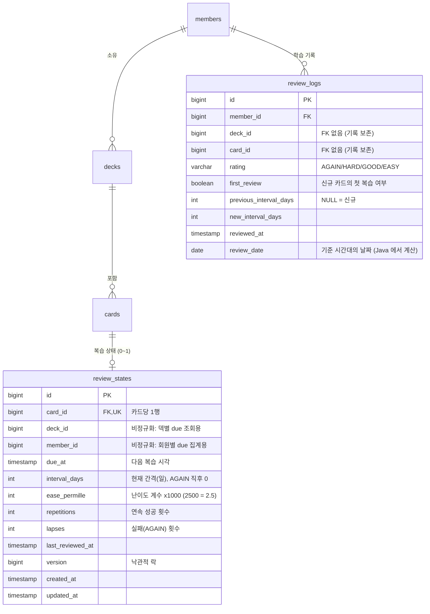

# 4단계 설계: 복습(SRS), 학습 기록, 통계

> 상태: **구현 완료** (2026-11-04). AI 기능은 이 단계 범위가 아닙니다.
> 구현 중 변경: 성질 테스트에서 발견한 문제로 n = 1 의 GOOD 과 HARD 규칙을 고쳤습니다 (2절 "구현 중 수정" 참고).
> 검토 때 확정한 사항: 확인 요청 7개는 모두 제안대로 진행. 신규 카드 수 계산 방식, 연속 학습일 규칙과 조회 범위(366일)를 아래에 추가로 명시함.

## 1. ERD 변경



### 인덱스

| 테이블 | 인덱스 | 쓰는 곳 |
|---|---|---|
| `review_states` | **UNIQUE** `(card_id)` | 카드의 상태 조회, 첫 복습 동시 생성 방지, 신규 카드 판별(`NOT EXISTS`) |
| `review_states` | `(deck_id, due_at)` | 덱의 기한 도래 카드 목록 (`deck_id = ? AND due_at <= now ORDER BY due_at`) |
| `review_states` | `(member_id, due_at)` | 통계: 지금 기한 지난 카드 수 |
| `review_logs` | `(member_id, review_date)` | 오늘 복습 수, 오늘 신규 수, 최근 7일 정답률, 날짜별 복습 수, 연속 학습일 |

### 비정규화 컬럼을 둔 이유

`review_states.deck_id`와 `member_id`는 `cards → decks`를 따라가면 알 수 있는 값입니다. 그래도 컬럼으로 둔 이유:

- 기한 도래 조회(`due_at <= now`)는 이 앱에서 가장 자주 실행되는 쿼리입니다. 조인 없이 `(deck_id, due_at)` 인덱스 하나로 범위 스캔할 수 있습니다.
- 카드를 다른 덱으로 옮기는 API가 없어서 값이 바뀌지 않습니다. 어긋날 위험이 낮습니다. (나중에 이동 기능을 만들면 함께 갱신해야 합니다. 이 문서에 남겨 둡니다.)

### 삭제 정책

| 삭제 대상 | review_states | review_logs |
|---|---|---|
| 카드 삭제 | 해당 카드 상태 삭제 | **보존** |
| 덱 삭제 | 덱의 상태 일괄 삭제 (카드 삭제 전에) | **보존** |

- 리뷰 로그는 "그날 공부했다"는 사실의 기록입니다. 덱을 지웠다고 연속 학습일이나 지난 통계가 바뀌면 사용자가 혼란스럽습니다. 그래서 `review_logs.card_id`와 `deck_id`에는 외래키를 두지 않습니다.
- `member_id`에는 외래키를 둡니다.
- 덱 삭제는 3단계와 같은 방식(서비스에서 직접 벌크 삭제, flush/clear)을 씁니다. 순서는 상태 → 카드 → 덱입니다.

## 2. 복습 알고리즘 (SM-2 단순화)

`SrsScheduler`: Spring에 의존하지 않는 순수 클래스입니다. 입력(현재 상태, 평가, 현재 시각, 시간대)을 받아 새 상태를 돌려줍니다. 현재 시각은 호출하는 쪽이 `Clock`에서 읽어 넘깁니다. 그래서 단위 테스트에 Spring이 필요 없습니다.

### 상수

| 이름 | 값 | 의미 |
|---|---|---|
| `EASE_INITIAL` | 2.5 | 신규 카드의 난이도 계수 |
| `EASE_MIN` | 1.3 | 계수 하한 (너무 자주 나오는 것 방지) |
| `RELEARN_DELAY` | 10분 | AGAIN 후 다시 나올 때까지 |
| `MAX_INTERVAL` | 365일 | 간격 상한 |

신규 카드는 상태 행이 없습니다. 첫 복습 때 `repetitions = 0, interval = 0, ease = 2.5, lapses = 0`으로 보고 계산합니다.

### 규칙 (n = 연속 성공 횟수, I = 현재 간격(일), EF = 난이도 계수)

| 평가 | 새 n | 새 EF | 새 간격 I' | 다음 복습 시각 |
|---|---|---|---|---|
| **AGAIN** | 0 | `max(1.3, EF − 0.20)` | 0 | `now + 10분` (lapses + 1) |
| **HARD** | n + 1 | `max(1.3, EF − 0.15)` | n = 0: **1**<br>n ≥ 1: `min(GOOD 간격, max(1, round(I × 1.2)))` | 날짜 정렬 (아래) |
| **GOOD** | n + 1 | EF (변화 없음) | n = 0: **1**<br>n = 1: `max(3, I + 1)`<br>n ≥ 2: `max(I + 1, round(I × EF))` | 날짜 정렬 |
| **EASY** | n + 1 | EF + 0.15 | n = 0: **4**<br>n ≥ 1: `max(GOOD 간격 + 1, round(I × EF × 1.3))` | 날짜 정렬 |

- 모든 간격은 `min(I', 365)`로 자릅니다.
- `round`는 반올림(half-up)입니다. EASY의 EF는 갱신 전 값을 씁니다.
- 보장되는 관계: n ≥ 1이면 `HARD ≤ GOOD < EASY`입니다(365일 상한에 걸린 경우는 같을 수 있음). GOOD은 항상 이전 간격보다 1일 이상 늘어납니다. 그래서 EF가 하한에 붙어도 간격이 멈추지 않습니다.
- EF는 `ease_permille`(정수 ×1000)로 저장합니다. 0.15씩 더하고 빼는 과정에서 부동소수 오차가 쌓이지 않게 하기 위해서입니다. API에는 `2.5`처럼 소수로 보여줍니다.
- 기한 전에 복습해도(조기 복습) 막지 않고 같은 규칙으로 계산합니다.

### 구현 중 수정

처음 설계에서는 n = 1의 GOOD을 **3일로 고정**했고, HARD는 GOOD과 비교하지 않았습니다. 그런데 "n ≥ 1이면 HARD ≤ GOOD < EASY이고 GOOD은 현재 간격보다 길다"는 성질을 여러 입력 조합으로 검사하는 테스트가 실패했습니다.

- 첫 복습을 **EASY**로 하면 n = 1, I = 4가 됩니다. 이 상태에서 GOOD을 누르면 간격이 4일에서 **3일로 줄어듭니다.**
- 같은 상태에서 HARD는 round(4 × 1.2) = 5일이 되어, **HARD가 GOOD보다 길어집니다.**

그래서 다음처럼 고쳤습니다.
- n = 1의 GOOD을 `max(3, I + 1)`로 바꿨습니다.
- HARD는 GOOD 간격을 넘지 않게 `min`으로 잘랐습니다.
- 이 경우(n = 1, I = 4)를 표 테스트에 추가했습니다.

### 예시 (신규 카드를 계속 GOOD)

| 복습 | n | I(일) | EF |
|---|---|---|---|
| 1회 | 0 → 1 | 1 | 2.5 |
| 2회 | 1 → 2 | 3 | 2.5 |
| 3회 | 2 → 3 | round(3 × 2.5) = 8 | 2.5 |
| 4회 | 3 → 4 | round(8 × 2.5) = 20 | 2.5 |

### 다음 복습 시각: 날짜 정렬

간격이 1일 이상이면 `due_at = (오늘 + I').atStartOfDay(기준 시간대)`입니다. **"그날 자정부터"** 복습할 수 있습니다.

- 정확한 시각(`now + I일`)으로 정하면, 어제 밤 11시에 공부한 카드는 오늘 밤 11시가 되어야 나옵니다. 사용자는 "오늘 할 복습"을 아침에 끝내고 싶어 합니다.
- 23:59에 GOOD(I = 1)으로 평가하면 1분 뒤인 자정에 다시 나옵니다. 하루 단위 학습 앱에서는 자연스러운 동작으로 보고 받아들입니다.
- AGAIN만 예외로 정확한 시각(10분 뒤)을 씁니다. 같은 학습 세션 안에서 다시 보게 하려는 것입니다.

## 3. 날짜 경계 (기준 시간대)

- 설정 `app.study.zone`의 기본값은 **`Asia/Seoul`**입니다.
- "오늘", "어제", 연속 학습일, 날짜별 통계, 날짜 정렬 due 시각은 모두 이 시간대의 **자정**을 경계로 합니다.

**Asia/Seoul을 기본으로 하는 이유**
- 사용자가 한국어 사용자입니다. 서버(또는 클라우드)는 보통 UTC로 돌아가는데, UTC 자정은 한국 오전 9시입니다. 서버 시간대를 따르면 "오늘"이 오전 9시에 바뀝니다.
- JVM 기본 시간대(`ZoneId.systemDefault()`)에 의존하지 않고, 설정으로 명시합니다. 배포 환경이 바뀌어도 결과가 같습니다.
- 회원별 시간대는 아직 지원하지 않습니다. 해외 사용자가 생기면 `members.time_zone` 컬럼을 추가하고, 이 설정은 기본값으로 쓰면 됩니다.

**DB 이식성을 위한 처리: 날짜 계산은 DB가 아니라 Java에서 합니다**
- 시각을 특정 시간대의 날짜로 바꾸는 SQL은 DB마다 다릅니다. PostgreSQL은 `AT TIME ZONE`, H2는 다른 함수를 씁니다.
- 그래서 리뷰를 저장할 때 Java에서 `review_date = reviewedAt.atZone(zone).toLocalDate()`를 계산해 `DATE` 컬럼으로 함께 저장합니다.
- 통계 쿼리는 `review_date`로 비교하고 `GROUP BY` 합니다. 표준 SQL만 쓰므로 H2와 PostgreSQL에서 똑같이 동작합니다.
- 범위 조건도 Java에서 계산한 값(`LocalDate`, `Instant`)을 파라미터로 넘깁니다.
- 대가: 운영 중에 `app.study.zone`을 바꾸면, 이미 저장된 로그의 `review_date`는 예전 시간대 기준으로 남습니다. 바꿔야 할 때는 마이그레이션으로 다시 계산해야 합니다. README 체크리스트에 적습니다.

### 연속 학습일

**규칙**
- 리뷰가 1건 이상 있는 날을 "학습한 날"로 봅니다(기준 시간대의 날짜).
- 오늘 학습했으면 오늘부터 거꾸로, 끊김 없이 이어진 날 수를 셉니다.
- **오늘 아직 학습하지 않았어도 어제까지의 연속은 유지합니다.** 오늘이 끝날 때까지는 끊기지 않은 것으로 봅니다. 이 경우 어제부터 거꾸로 셉니다.
- 하루를 건너뛰면 0부터 다시 셉니다. 예: 오늘도 어제도 기록이 없으면 0입니다.

| 오늘 | 어제 | 그제 | 3일 전 | 연속 학습일 |
|---|---|---|---|---|
| O | O | O | X | 3 |
| X | O | O | X | 2 (오늘은 아직 끊기지 않음) |
| O | X | O | O | 1 (어제를 건너뛰어 다시 시작) |
| X | X | O | O | 0 |

**조회 범위와 쿼리 수**
- 쿼리 1개로 계산합니다. 전체 로그는 읽지 않습니다.
  ```sql
  SELECT DISTINCT review_date FROM review_logs
  WHERE member_id = ? AND review_date BETWEEN (오늘 - 365일) AND 오늘
  ORDER BY review_date DESC
  ```
- 범위는 오늘을 포함한 **최근 366일**입니다. 결과는 날짜 값만 최대 366개이고, 로그 행은 메모리에 올리지 않습니다. `(member_id, review_date)` 인덱스로 범위 스캔합니다.
- Java에서 이 날짜 목록을 거꾸로 따라가며 셉니다.
- 따라서 **표시되는 연속 학습일의 최댓값은 366일**입니다. 1년 넘게 매일 학습한 경우에도 366으로 표시됩니다. 더 길게 보여줘야 하면 회원별 연속 기록을 따로 저장하는 방식을 검토합니다.

## 4. 신규 카드 한도

- 설정 `app.study.daily-new-card-limit`의 기본값은 20입니다.
- **신규 카드**는 `review_states` 행이 없는 카드입니다.
- **오늘 시작한 신규 카드 수**는 `review_logs` 테이블에서 계산합니다.
  ```sql
  SELECT COUNT(*) FROM review_logs
  WHERE member_id = ? AND review_date = 오늘 AND first_review = TRUE
  ```
  - `first_review`는 복습할 때 그 카드의 `review_states` 행이 아직 없었으면 `true`입니다. 즉 그 카드의 첫 복습입니다.
  - 상태 테이블(`review_states.created_at`)로 세지 않는 이유가 있습니다. 카드나 덱을 지우면 상태 행도 지워지기 때문입니다. 오늘 신규 카드를 공부한 뒤 덱을 지우면 한도가 다시 차는 문제가 생깁니다. 로그는 보존되므로 이 문제가 없습니다.
  - `(member_id, review_date)` 인덱스로 오늘 범위만 읽습니다.
- **남은 신규 한도** = `max(0, 한도 − 오늘 시작한 신규 카드 수)`
- 신규 카드를 한 장 복습하면 그 카드에 상태 행이 생겨 신규가 아니게 됩니다. 그래서 due 목록의 신규 칸에서 빠지고, 남은 신규 한도는 1 줄어듭니다.
- **한도 범위: 회원 단위 (모든 덱 합산)입니다.** 한도의 목적은 하루 학습량 조절입니다. 덱별로 두면 덱 수만큼 한도가 늘어납니다.
- **적용 시점: due 목록을 만들 때만 적용합니다.** `남은 신규 수 = max(0, 한도 − 오늘 사용한 신규 수)`만큼만 새 카드를 목록에 넣습니다.
  - 복습 API(POST)는 한도 때문에 막지 않습니다. 사용자가 직접 고른 카드를 공부하는 것은 허용합니다(Anki와 같은 방식).
  - 이렇게 하면 "한도 직전에 두 요청이 동시에 들어오는" 경우의 경쟁 조건도 생기지 않습니다.
- 신규 카드 순서는 카드를 추가한 순서(`created_at, id` 오름차순)입니다.

## 5. due 목록 구성

`GET /api/decks/{deckId}/study/due?limit=`

1. 기한이 지난 카드: `deck_id = ? AND due_at <= now`, `due_at` 오름차순, 최대 `limit`개
2. 남은 자리(`limit − 1번 개수`)를 신규 카드로 채웁니다. 오늘 남은 신규 한도를 넘지 않습니다.
   - 조건: `cards.deck_id = ? AND NOT EXISTS (review_states)`

- `limit`의 기본값은 20, 최대 100입니다. 더 크게 요청하면 100으로 잘립니다(페이지 크기와 같은 방식). 1 미만이면 400입니다.
- 쿼리 수는 고정입니다: 덱 소유 확인, 기한 카드, 오늘 신규 수, 신규 카드. 기한 카드와 카드 내용은 `JOIN FETCH`로 한 번에 가져옵니다.

## 6. 동시성 (낙관적 락)

- `review_states.version`에 `@Version`을 붙입니다. 상태를 갱신할 때 `UPDATE ... WHERE id = ? AND version = ?`가 0행이면 충돌입니다.
  - 상황: 같은 카드에 대한 두 복습 요청이 같은 버전을 읽고, 둘 다 갱신하려는 경우
- 신규 카드 첫 복습이 동시에 들어오면 두 요청이 모두 INSERT를 시도합니다. 이때는 `UNIQUE(card_id)` 위반이 납니다.
- 두 경우 모두 **409 `REVIEW_CONFLICT`**를 반환합니다. 트랜잭션은 롤백되므로 리뷰 로그도 남지 않습니다.
- 서비스에서 `saveAndFlush`를 써서 충돌을 메서드 안에서 감지하고, 409로 바꿉니다. 커밋 시점까지 미루지 않습니다.
- 클라이언트는 409를 받으면 due 목록을 다시 받아 오면 됩니다. 자동 재시도는 하지 않습니다. 같은 평가가 두 번 반영되는 것보다는 한 번만 반영되는 게 맞기 때문입니다.

## 7. 통계

모든 통계는 DB 집계 쿼리(`COUNT`, `SUM(CASE ...)`, `GROUP BY`)로 계산하고, 로그 행은 메모리에 올리지 않습니다.

### `GET /api/stats/summary`

| 필드 | 계산 |
|---|---|
| `today` | 기준 시간대의 오늘 날짜 |
| `todayReviews` | `COUNT(*) WHERE member_id = ? AND review_date = 오늘` |
| `dueCards` | `COUNT(*) FROM review_states WHERE member_id = ? AND due_at <= now` (신규 카드는 제외) |
| `streakDays` | 3절의 연속 학습일 (최근 366일의 `DISTINCT review_date`, 최대 366) |
| `last7Days.reviews` / `.correct` / `.accuracy` | `review_date BETWEEN 오늘-6 AND 오늘`에서 `COUNT(*)`, `SUM(CASE WHEN rating <> 'AGAIN' THEN 1 ELSE 0 END)` → `accuracy = correct / reviews`. 리뷰가 없으면 `null` |
| `timeZone` | 적용된 기준 시간대 |

쿼리 4개로 고정입니다. 로그가 10건이든 10만 건이든 같습니다.

### `GET /api/stats/daily?from=YYYY-MM-DD&to=YYYY-MM-DD`

- `GROUP BY review_date` 한 번으로 계산합니다. 기록이 없는 날은 Java에서 0으로 채워서, 기간 안의 모든 날짜가 응답에 나옵니다.
- `from`과 `to`는 필수이고 양 끝을 포함합니다.
  - `from > to`이면 400입니다.
  - **기간이 90일을 넘으면 400**입니다(`INVALID_INPUT`). 날짜는 조용히 잘라 주면 사용자가 알아채기 어려우므로, 자르지 않고 에러로 알립니다.
- 응답: `{from, to, days: [{date, reviews}]}`

## 8. API 목록

모든 API는 인증이 필요합니다. 기존 규칙을 그대로 따릅니다: 남의 덱·카드는 404, Validation, 공통 에러 형식.

| 메서드 | 경로 | 요청 | 성공 응답 |
|---|---|---|---|
| GET | `/api/decks/{deckId}/study/due?limit=` | - | 200 `{deckId, dueCount, newCount, remainingNewToday, cards: [...]}` |
| POST | `/api/decks/{deckId}/cards/{cardId}/reviews` | `{rating}` (`AGAIN`/`HARD`/`GOOD`/`EASY`) | 200 `ReviewResponse` |
| GET | `/api/stats/summary` | - | 200 요약 |
| GET | `/api/stats/daily?from=&to=` | - | 200 날짜별 |

**due 카드 항목**: `{cardId, text, reading, meaning, example, isNew, dueAt, intervalDays, repetitions}` (신규면 `dueAt` 등은 `null`)

**ReviewResponse**:
```json
{ "cardId": 10, "rating": "GOOD", "reviewedAt": "...",
  "previousIntervalDays": 3, "intervalDays": 8, "easeFactor": 2.5,
  "repetitions": 3, "lapses": 0, "dueAt": "2026-11-12T15:00:00Z" }
```

### 추가 에러 코드

| code | HTTP | 상황 |
|---|---|---|
| `REVIEW_CONFLICT` | 409 | 같은 카드에 대한 복습이 동시에 처리되어 충돌 |

- `rating`이 없으면 400 `INVALID_INPUT`입니다.
- `rating`이 정의되지 않은 값이면 400 `MALFORMED_REQUEST`입니다(JSON을 enum으로 변환하지 못함).

## 9. 설정

```yaml
app:
  study:
    zone: Asia/Seoul            # 날짜 경계 기준 시간대
    daily-new-card-limit: 20    # 회원당 하루 신규 카드 수
```

`StudyProperties`(`@ConfigurationProperties`)로 받습니다. 잘못된 시간대 문자열이나 음수 한도는 기동할 때 실패시킵니다.

## 10. 패키지 배치

```
srs/          SrsScheduler, ReviewSchedule(상태 값 객체), Rating   ← Spring 의존 없음
domain/       ReviewState, ReviewLog
repository/   ReviewStateRepository, ReviewLogRepository (+ 집계 projection)
service/      StudyService(due, review), StatsService
controller/   StudyController, StatsController (+ dto)
config/       StudyProperties
```

## 11. 테스트 계획

| 분류 | 내용 |
|---|---|
| 알고리즘 단위 | 평가별 n/I/EF 변화를 표(`@CsvSource`)로 검증. EF 하한 1.3, 간격 상한 365, `HARD ≤ GOOD < EASY`, 날짜 정렬(자정), AGAIN의 10분 |
| 시간 조작 통합 | `MutableClock`으로 기한 도래 전에는 목록에 없고 후에는 있음, 23:59 → 00:00 경계 |
| 연속 학습일 | 연속 3일, 하루 건너뜀(끊김), 오늘 없고 어제 있음(유지), 자정 직전/직후 리뷰가 서로 다른 날로 계산, 400일 연속이어도 366 |
| 신규 한도 | 한도만큼만 목록에 나옴, 신규 카드를 복습하면 남은 한도가 1 줄고 due 목록에서 빠짐, 다음 날 다시 채워짐, 덱을 지워도 오늘 한도는 되돌아오지 않음 |
| 통계 정확성 | 오늘 복습 수, 기한 지난 수, 7일 정답률, 날짜별(빈 날 0), 기간 90일 초과 400, `from > to` 400 |
| 소유자 404 | 남의 덱 due, 남의 카드 복습 → 404. 통계는 내 기록만 포함 |
| 동시성 | 같은 카드의 동시 복습 중 하나가 409이고, 로그는 1건만 남음 |
| 쿼리 수 | 로그 10건과 수백 건에서 summary와 daily의 쿼리 수가 같음 |
| 삭제 | 덱·카드 삭제 시 상태는 지워지고 로그는 남음. 통계는 유지 |

### 검증: 일부러 버그를 넣었을 때 테스트가 잡는지

버그를 하나씩 넣고 해당 테스트를 실행한 뒤 원래대로 되돌렸습니다. 6개 모두 테스트가 실패해서 잡아냈습니다.

| 넣은 버그 | 잡은 테스트 |
|---|---|
| M1 GOOD 간격을 `I × EF / 1.1`로 계산 | `SrsSchedulerTest` 표 테스트, 문서 예시(1→3→8→20) |
| M2 `review_date`를 UTC로 계산 | `reviewDateUsesStudyZoneNotUtc`, `streakAcrossMidnightUsesStudyZone` |
| M3 `@Version` 제거 | `concurrentReviewOfSameCardConflicts` |
| M4 연속 학습일을 하루씩 COUNT 쿼리로 계산 (데이터 양에 비례) | `statsQueryCountDoesNotGrowWithData` |
| M5 오늘 복습이 없으면 연속 학습일을 바로 끊음 | `streakRules`, `streakAcrossMidnightUsesStudyZone` |
| M6 신규 한도에 모든 복습을 셈 (`first_review` 무시) | `reviewingStartedCardDoesNotUseNewLimit` |

M6은 처음에는 잡는 테스트가 없었습니다. "이미 시작한 카드를 복습해도 신규 한도가 줄지 않는다"는 테스트를 추가해서 잡히게 했습니다.

동시 복습 테스트는 두 가지입니다.
- **`concurrentReviewOfSameCardConflicts`:** "A가 읽음 → B가 커밋 → A가 갱신" 순서를 결정적으로 만들어 409를 확인합니다.
- **`parallelReviewsNeverLoseUpdates`:** 실제 요청 8개를 동시에 보냅니다. 몇 개가 409가 될지는 타이밍에 따라 다릅니다. 하지만 어떤 경우에도 "200 응답 수 = 반영된 복습 수 = 로그 수"인지 확인합니다. 5회 반복 실행해서 모두 통과했습니다.

## 12. 설명 요약

### (1) SM-2 단순화: 한 카드를 3번 복습하면

신규 카드(n = 0, I = 0, EF = 2.50)를 서울 시각 11월 4일 오전 10시부터 복습한다고 해 보겠습니다.

| 회차 | 평가 | 계산 | 결과 (n, I, EF) | 다음 복습 |
|---|---|---|---|---|
| 1 | GOOD | n = 0이라 I' = 1, EF 그대로 | (1, 1일, 2.50) | 11/5 00:00 |
| 2 | EASY | GOOD이었다면 max(3, 1 + 1) = 3 → EASY = max(3 + 1, round(1 × 2.5 × 1.3) = 3) = **4**, EF + 0.15 | (2, 4일, 2.65) | 4일 뒤 00:00 |
| 3 | AGAIN | n과 I를 0으로 되돌림, EF − 0.20, 실패 + 1 | (0, 0일, 2.45), lapses 1 | **10분 뒤** |

- **평가별 의미:**
  - GOOD은 간격을 "현재 × EF"만큼 늘리는 기본 동작입니다.
  - EASY는 간격을 더 크게 늘리고 계수도 올립니다. 그래서 이 카드는 앞으로 더 빨리 멀어집니다.
  - HARD는 간격을 조금만(×1.2) 늘리고 계수를 내립니다.
  - AGAIN은 연속 성공을 0으로 되돌리고 계수를 크게 내립니다. 그래서 다시 외운 뒤에도 간격이 천천히 늘어납니다.
- **3회차 뒤:** 10분 뒤 다시 GOOD을 하면 n = 0부터 시작하므로 1일, 3일, ...로 다시 늘어납니다. 대신 EF가 2.45로 낮아져서 이전보다 천천히 늘어납니다.

### (2) `review_date`를 SQL이 아니라 Java에서 계산해 저장한 이유

- **DB마다 함수가 다릅니다.** "이 시각은 서울 기준으로 며칠인가"를 SQL로 구하려면 PostgreSQL은 `(reviewed_at AT TIME ZONE 'Asia/Seoul')::date`를 씁니다. H2는 문법과 동작이 다릅니다. Java에서 `reviewedAt.atZone(zone).toLocalDate()`로 계산해 `DATE` 컬럼에 저장하면, 통계 쿼리는 `review_date = ?`, `BETWEEN`, `GROUP BY review_date` 같은 표준 SQL만 씁니다. 그래서 H2와 PostgreSQL에서 같은 쿼리가 그대로 동작합니다.
- **인덱스를 쓸 수 있습니다.** `GROUP BY 함수(reviewed_at)`는 함수 기반 인덱스가 없으면 행마다 함수를 계산해야 합니다. 저장된 `review_date`는 `(member_id, review_date)` 인덱스로 바로 범위 스캔합니다.
- **기준이 한 곳에 있습니다.** "오늘"을 정하는 시간대(`app.study.zone`)가 Java 설정 한 곳에만 있습니다. DB 세션의 시간대 설정에 영향받지 않습니다.
- **대가:** 저장 시점의 시간대로 날짜가 고정됩니다. 운영 중에 시간대 설정을 바꾸면 과거 로그의 `review_date`를 다시 계산해야 합니다.

### (3) 낙관적 락(`@Version`)을 고른 이유와 비관적 락과의 차이

| | 낙관적 락 (`@Version`) | 비관적 락 (`SELECT ... FOR UPDATE`) |
|---|---|---|
| 방식 | 잠그지 않고 읽은 뒤, 쓸 때 `WHERE version = 읽은 값`으로 확인. 0행이면 충돌 | 읽을 때 행을 잠가서, 다른 트랜잭션은 커밋될 때까지 기다림 |
| 충돌 시 | 나중에 쓰려는 쪽이 즉시 실패 → 409 | 뒤 요청이 기다렸다가 갱신된 값으로 이어서 처리 |
| 비용 | 충돌이 없으면 추가 비용이 거의 없음 | 매번 잠금. 대기 시간이 생기고, 순서를 잘못 쓰면 교착 상태 위험 |
| 어울리는 경우 | 충돌이 드물고, 충돌하면 "다시 하라"고 알려도 되는 경우 | 충돌이 잦고, 모든 요청이 반드시 순서대로 반영되어야 하는 경우 (예: 재고 차감) |

이 앱에서 낙관적 락을 고른 이유:
- **충돌이 드뭅니다.** 같은 카드에 대한 복습이 동시에 들어오는 일은 버튼 연타나 두 기기 동시 사용 정도로 드뭅니다. 드문 경우를 위해 모든 복습 요청이 잠금 비용을 낼 필요가 없습니다.
- **둘 다 반영되면 오히려 틀립니다.** 한 번 본 카드를 두 번 평가한 셈이 되어 간격이 두 번 늘어납니다. 비관적 락은 두 요청을 차례로 모두 반영하지만, 낙관적 락은 하나만 반영하고 나머지는 409로 알려 줍니다.
- **DB 이식성이 좋습니다.** `@Version`은 평범한 `UPDATE ... WHERE version = ?`라서 H2와 PostgreSQL에서 똑같이 동작합니다. 잠금 대기와 타임아웃은 DB마다 다르게 동작합니다.
- **첫 복습 동시 요청도 처리합니다.** 이 경우는 `@Version`이 아니라 `UNIQUE(card_id)` 제약이 막습니다. 둘 다 409 `REVIEW_CONFLICT`로 응답합니다.
