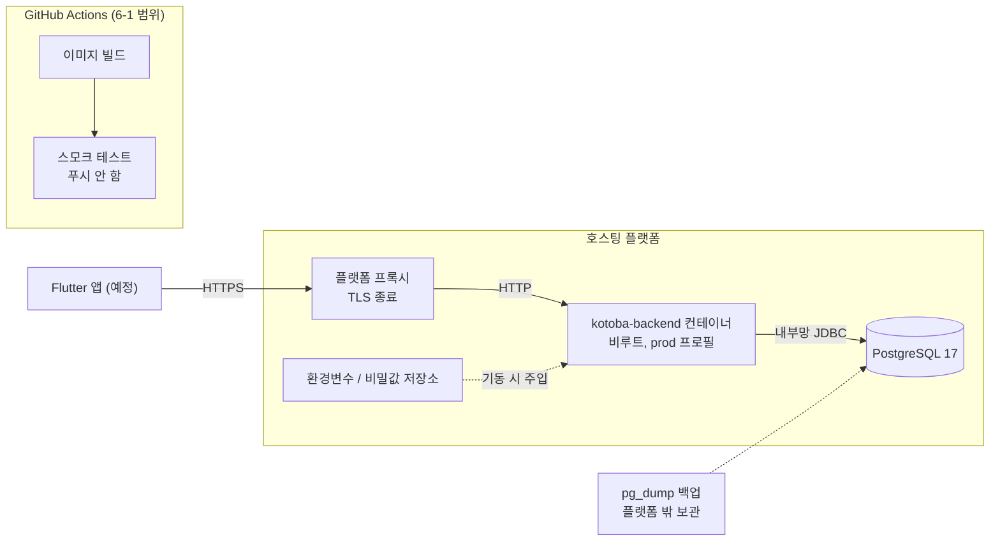

# 6단계 설계: 배포 준비 (6-1 컨테이너화와 CI 검증)

> **후보 표(3절)의 출처 주의:** 가격과 무료 조건은 공식 문서 페이지를 **요약 도구를 거쳐 읽은 내용**입니다. 원문 대조를 하지 않았으므로, **6-2에서 계정을 만들기 직전에 원문을 다시 확인합니다.**
>
> 상태: **6-1 완료, main 반영 완료** (2026-11-05, 커밋 `7a863bf`, CI 실행 [42004374387](https://github.com/monenon-dev/kotoba/actions/runs/42004374387)에서 세 작업 모두 통과). 실제 배포는 6-2에서 다룹니다. 검토 때 확정 사항: 추천안, `.env.example` 루트 이동, Compose CI 검사, 임시 브랜치 검증, `.gitignore` 추가, 측정을 모두 제안대로 진행.
> 6-1의 범위는 컨테이너화와 CI 검증까지입니다. 실제 배포, 서비스 계정 생성(Render 포함), 클라우드 CLI 사용, 레지스트리 푸시는 하지 않았습니다.
> 실험 결과는 8절, 메모리와 기동 시간 측정은 9절을 참고하세요.

## 1. 목표와 제약

- **목표:** 어디에 올리든 쓸 수 있는 이미지를 만들고, 그 이미지가 실제로 뜨는지와 잘못된 설정을 거부하는지를 CI에서 확인합니다.
- **제약 1:** 로컬에 Docker가 없어서 이미지 빌드와 실행은 GitHub Actions에서만 검증할 수 있습니다.
- **제약 2:** AWS는 계정 문제로 지금 쓰지 않습니다.
- **가장 중요한 선택 기준:** 카드 등록 없이 시작할 수 있는지입니다.

## 2. 배포 구조

올릴 곳이 정해지지 않았으므로, 플랫폼에 의존하지 않는 형태로 그렸습니다.



**이 구조의 한계**

| 한계 | 영향 |
|---|---|
| 앱 1개, DB 1개 | 둘 중 하나가 죽으면 서비스가 멈춥니다. 무중단 배포와 장애 조치가 없습니다. |
| CI 이미지와 운영 이미지가 다름 | 레지스트리에 푸시하지 않으므로, 플랫폼이 Dockerfile로 다시 빌드합니다. CI가 검증한 이미지와 같은 파일 내용에서 빌드되지만, 같은 결과물은 아닙니다. |
| 스모크 테스트의 범위 | 기동, 헬스체크, 설정 거부만 봅니다. 플랫폼의 메모리, CPU, 네트워크 조건은 재현하지 못합니다. |
| `/api/health`는 DB를 확인하지 않음 | `HealthController`는 항상 `UP`을 돌려줍니다. DB 상태는 `/actuator/health`에서 봐야 합니다. (7.3절에서 둘 다 확인) |
| 운영 관측 수단 없음 | 플랫폼 기본 로그 외에 모니터링과 알림이 없습니다. |
| 미해결 항목 | `refresh_tokens` 정리 배치와 커넥션 풀 조정이 아직 없습니다. (README 체크리스트) |
| H2가 이미지에 포함됨 | `build.gradle`의 `runtimeOnly h2`와 h2console 의존성이 운영 jar에도 들어갑니다. prod에서는 콘솔이 꺼져 있고 보안 설정도 열지 않습니다. 이번 단계에서는 바꾸지 않습니다. |

## 3. 올릴 곳 후보 비교

- **확인 날짜:** 표의 `11-05`는 모두 2026-11-05입니다.
- **읽는 법:** 공식 문서에서 확인한 내용만 적었습니다. 찾지 못한 내용은 **미확인**입니다.
- **주의:** 가격과 무료 조건은 자주 바뀝니다. 6-2에서 계정을 만들기 직전에 다시 확인해야 합니다.

| 항목 | Render | Railway | Fly.io | Google Cloud Run | AWS (나중에) |
|---|---|---|---|---|---|
| **카드 등록 필요 여부** | **불필요 (공식 문서 기준).** "No payment is required" ([첫 배포 문서](https://render.com/docs/your-first-deploy), 11-05), "No credit card is required" ([Render 글, 2026-04-23](https://render.com/articles/platforms-with-a-real-free-tier-for-developers-in-2026), 11-05). 포럼에 카드 확인을 요구받았다는 사례가 검색됐지만 원문을 열지 못해 **실제 가입 시 요구 여부는 미확인** | **현재 사실상 필요.** 가격 페이지는 체험에 카드가 불필요하다고 하지만 ([가격](https://railway.com/pricing.md), 11-05), 상태 페이지의 11-01 항목은 신규 고객이 배포 전에 유료 플랜을 구독해야 하고 체험 배포는 일시 중단이라고 합니다 ([상태 기록](https://status.railway.com/historical), 11-05). **재개 시점은 미확인** | **체험은 불필요, 이후 필요.** "You don't need a credit card to start the trial" ([가격](https://docs.fly.io/about/pricing), 11-05) | **필요.** 무료 체험에 카드 또는 다른 결제 수단 필수 ([무료 프로그램](https://docs.cloud.google.com/free/docs/free-cloud-features), 11-05) | **대부분 불필요.** 일부 가입자는 결제 수단 등 추가 확인 필요 ([FAQ](https://aws.amazon.com/free/free-tier-faqs/), 11-05) |
| **무료 사용 조건과 기간 제한** | 웹 서비스: 월 750 인스턴스 시간, 소진 시 다음 달까지 정지 ([무료 문서](https://render.com/docs/free), 11-05). 0.1 CPU, 512 MB ([플랜](https://render.com/docs/compute-plans), 11-05). 웹 서비스의 사용 기간 제한은 해당 문서에 언급 없음 | 체험: $5, 최대 30일 ([체험](https://docs.railway.com/reference/pricing/free-trial), 11-05). 이후 Free: 월 $1 크레딧, 서비스당 RAM 0.5 GB, vCPU 1개 ([플랜](https://docs.railway.com/reference/pricing/plans), 11-05) | 무료 등급 없음. $1 크레딧, 7일 또는 소진 시까지 ([가격](https://docs.fly.io/about/pricing), 11-05). 체험 Machine은 실행 5분 후 정지 ([체험](https://docs.fly.io/about/free-trial), 11-05) | 월 200만 요청, 360,000 GB-초, 180,000 vCPU-초. 체험 크레딧 $300, 90일 ([무료 프로그램](https://docs.cloud.google.com/free/docs/free-cloud-features), 11-05) | Free 플랜 최대 6개월, 크레딧 $100 + 최대 $100. 먼저 도달한 시점에 종료 ([FAQ](https://aws.amazon.com/free/free-tier-faqs/), 11-05) |
| **비활성 시 잠들기 / 콜드스타트** | 15분간 요청이 없으면 잠듦. 깨어나는 데 약 1분. 언제든 재시작될 수 있음 ([무료 문서](https://render.com/docs/free), 11-05) | Serverless 설정을 켠 경우 5~10분 후 잠듦. 첫 요청이 502일 수 있음. 기본 활성 여부 **미확인** ([문서](https://docs.railway.com/reference/app-sleeping), 11-05) | `fly launch`로 만든 앱은 기본이 scale to zero. 콜드스타트는 일반적인 앱 기준 약 2초 이상 ([문서](https://docs.fly.io/launch/autostop-autostart/), 11-05) | 0까지 축소, 요청이 오면 기동. 최소 인스턴스를 두면 유휴 시에도 과금 ([문서](https://docs.cloud.google.com/run/docs/about-instance-autoscaling), 11-05). 콜드스타트 수치 **미확인** | App Runner는 신규 고객 불가, ECS Express Mode 권장 ([문서](https://docs.aws.amazon.com/apprunner/latest/dg/what-is-apprunner.html), 11-05). ECS Express의 0까지 축소 여부 **미확인** |
| **PostgreSQL 제공 방식과 무료 한계** | 관리형. 무료는 1 GB, **생성 후 30일 만료**, 14일 유예 후 삭제, **백업 없음**, 워크스페이스당 1개 ([무료 문서](https://render.com/docs/free), 11-05). 접속 수 한도 **미확인** | 템플릿 컨테이너, 기본 비공개 ([문서](https://docs.railway.com/guides/postgresql), 11-05). Free 볼륨 0.5 GB ([플랜](https://docs.railway.com/reference/pricing/plans), 11-05). 체험 볼륨은 크레딧 만료 30일 후 삭제 ([체험](https://docs.railway.com/pricing/free-trial), 11-05). 백업 기능이 있으나 플랜별 사용 가능 여부 **미확인** ([백업](https://docs.railway.com/reference/backups), 11-05) | Managed Postgres는 Basic $38/월 + 저장소 $0.28/GB부터. 무료 언급 없음. 백업과 HA 포함 ([문서](https://docs.fly.io/postgres/), 11-05) | Cloud SQL은 Free Tier 표에 없음. 30일 체험 인스턴스만 있고 결제 수단 필수, 최종 백업 외 백업 불가, 운영 용도 아님 ([문서](https://docs.cloud.google.com/sql/docs/postgres/free-trial-instance), 11-05) | RDS PostgreSQL을 Free 플랜에서 db.t3.micro, db.t4g.micro로 최대 6개월 ([RDS 무료](https://aws.amazon.com/rds/free/), 11-05). 시간과 저장소 한도 **미확인** ([RDS 가격](https://aws.amazon.com/rds/pricing/), 11-05) |
| **환경변수 / 비밀값 관리** | 대시보드 환경변수, 환경 그룹, 비밀 파일(`/etc/secrets`). `render.yaml`에 비밀값 금지 ([문서](https://render.com/docs/configure-environment-variables), 11-05) | 서비스 변수, 값을 숨기는 sealed 변수 (해제 불가) ([문서](https://docs.railway.com/guides/variables), 11-05) | 앱별 암호화 저장소, 실행 시 환경변수로 주입 ([문서](https://docs.fly.io/apps/secrets/), 11-05) | Secret Manager를 환경변수 또는 볼륨으로 연결 ([문서](https://docs.cloud.google.com/run/docs/configuring/services/secrets), 11-05). 일반 환경변수에 비밀값을 두는 것은 비권장 ([문서](https://docs.cloud.google.com/run/docs/configuring/services/environment-variables), 11-05) | Secrets Manager, 사용량 과금 ([문서](https://docs.aws.amazon.com/secretsmanager/latest/userguide/intro.html), 11-05). ECS 주입 방식 **미확인** |
| **HTTPS와 도메인** | `onrender.com` 서브도메인 제공. 사용자 도메인은 인증서 자동 발급과 HTTPS 리디렉션, Hobby 2개 포함 ([문서](https://render.com/docs/custom-domains), 11-05). 기본 서브도메인의 HTTPS 명시와 무료 서비스의 사용자 도메인 적용 여부는 **미확인** | 자동 부여 아님, 생성하면 `*.up.railway.app`. 사용자 도메인은 Let's Encrypt 자동 발급, 체험 1개, Hobby 서비스당 2개. Free 플랜 개수 **미확인** ([문서](https://docs.railway.com/networking/domains/working-with-domains), 11-05) | `fly.dev` 서브도메인 자동 제공. 사용자 도메인은 Let's Encrypt ([문서](https://docs.fly.io/networking/custom-domain/), 11-05). 단일 호스트 인증서 첫 10개 무료 ([가격](https://docs.fly.io/about/pricing), 11-05) | HTTPS 주소 기본 제공 ([문서](https://docs.cloud.google.com/run/docs/triggering/https-request), 11-05). 사용자 도메인은 로드밸런서 권장, 도메인 매핑은 미리보기 단계이고 지원 리전 목록에 서울(`asia-northeast3`)이 없음 ([문서](https://docs.cloud.google.com/run/docs/mapping-custom-domains), 11-05) | ECS Express가 고유 URL과 TLS 로드밸런서 구성, 로드밸런서 비용 별도 ([문서](https://docs.aws.amazon.com/AmazonECS/latest/developerguide/express-service-overview.html), 11-05). 사용자 도메인 연결 방법 **미확인** |

**조사 중 알게 된 점**

- **Railway 상태:** 10월 21일 장애 뒤 가입을 중단했다가 다시 열었습니다. 11월 4일에도 일부 네트워크에서 접속 장애가 있다고 공지했습니다 ([상태](https://status.railway.com/), 11-05). 상태 페이지 내용이 일부 잘려서, 체험 배포가 그 뒤 재개됐는지는 확인하지 못했습니다.
- **AWS 문서 불일치:** 크레딧 만료가 FAQ 안에서도 6개월과 12개월로 다르게 적혀 있습니다.
- **조사 방식:** 페이지는 요약 도구를 거쳐 읽었습니다. 인용문과 수치는 6-2에서 원문으로 다시 확인합니다.

## 4. 추천안: Render 무료로 시연부터 시작

**추천:** 6-2에서 Render 무료 웹 서비스와 무료 PostgreSQL로 시작합니다.

> **Render 무료 환경은 30일 시연용이며 데이터가 초기화될 수 있습니다.** 무료 PostgreSQL은 생성 후 30일이 지나면 만료되고 백업 기능이 없습니다.
> **만료 후 복구:** 무료 DB는 1개만 둘 수 있으므로 기존 DB를 지우고 새 DB를 만든 뒤 앱의 접속 정보를 바꿔 재배포하면 Flyway가 스키마를 다시 만듭니다. 이전 데이터는 복구되지 않으며, 데모 데이터 시딩은 6-2에서 다룹니다.

**이유**

1. **카드 없이 시작할 수 있다고 공식 문서가 밝힌 후보 중, 앱을 계속 띄워 둘 수 있는 곳은 Render뿐입니다.**
   - Fly.io는 카드 없이 시작할 수 있지만 체험 Machine이 5분 후 정지하고 크레딧도 7일이면 끝납니다.
   - Railway는 지금 신규 고객에게 유료 구독을 요구합니다.
   - Cloud Run은 결제 수단이 필수입니다.
   - AWS는 계정 문제로 제외합니다.
2. **이미지를 그대로 씁니다.** Render는 레포의 Dockerfile로 빌드합니다 ([문서](https://render.com/docs/docker), 11-05). 6-1의 결과물을 바로 쓸 수 있습니다.
3. **DB를 외부에서 막을 수 있습니다.** 같은 리전은 내부 URL로 연결하고, 외부 접속은 IP 허용 목록을 비워 차단합니다 ([문서](https://render.com/docs/postgresql-creating-connecting), 11-05).

**이 추천의 위험**

| 위험 | 내용 | 대응 |
|---|---|---|
| **DB 만료** | 무료 DB는 30일 후 만료되고, 백업 기능이 없으며, 1개만 둘 수 있습니다. | 실제 사용자 데이터를 넣지 않습니다. 계속 쓰려면 유료 전환이나 DB 분리를 그때 결정합니다. |
| **자원 부족** | CI에서 같은 제한을 걸어 측정한 결과, 힙 비율을 낮추면 512 MB에서 뜨고 요청도 처리합니다. 다만 Render에서 잰 값은 아닙니다. | 힙 상한 40% 적용 (9.2절). 6-2에서 Render에서 다시 측정합니다. |
| **콜드스타트** | 15분 동안 요청이 없으면 잠들고, 다음 요청에 **약 2~4분**이 걸릴 수 있습니다 (CI 측정값, 문서의 "약 1분"보다 김). | 9.3절. Flutter 앱에 대기 안내와 긴 타임아웃이 필요합니다. 깨우기용 주기 호출은 쓰지 않습니다. |
| **카드 요구 가능성** | 포럼 사례처럼 가입 때 카드를 요구받을 수 있습니다. | 요구받으면 등록하지 않고 멈춰서 다시 논의합니다. |

**DB만 계속 유지하고 싶을 때의 대안 (후보 밖)**

Neon 무료 플랜은 비교 대상이 아니지만, 30일 만료 문제의 대안이라 적어 둡니다. 기간 제한이 없고 카드가 필요 없다고 안내합니다 ([가격](https://neon.com/pricing), 11-05). 저장소는 1 GB입니다. 다만 IP 허용 목록은 무료 플랜에서 제공하지 않아 ([플랜](https://neon.com/docs/introduction/plans), 11-05) **"DB를 외부에 열지 않는다"는 원칙을 지킬 수 없습니다.** 지금은 채택하지 않습니다.

## 5. 운영 원칙

### 5.1 비밀값 (`JWT_SECRET`, DB 비밀번호)

- **저장 위치:** 운영은 플랫폼의 비밀값 저장소, 자체 실행은 커밋되지 않는 `.env`입니다. 이미지와 레포에는 넣지 않습니다.
- **이미지에 남기지 않기:** `ENV`, `ARG`로 비밀값을 받지 않습니다. `.dockerignore`로 `.env`가 빌드 컨텍스트에 들어가지 않게 합니다.
- **생성:** `JWT_SECRET`은 `openssl rand -base64 48`로 만들고, 환경마다 다른 값을 씁니다.
- **CI:** `ci-only-` 접두사가 붙은 가짜 값만 씁니다. `secrets.*`는 쓰지 않습니다.
- **교체:** `JWT_SECRET`을 바꾸면 기존 Access Token이 모두 무효가 됩니다. DB 비밀번호는 아래 주의 사항이 있습니다.
- **주의:** PostgreSQL 이미지의 `POSTGRES_PASSWORD`는 **데이터 디렉터리를 처음 만들 때만** 적용됩니다. `.env`만 바꾸면 앱과 DB의 비밀번호가 어긋납니다. DB 안에서 `ALTER USER`로 함께 바꿔야 합니다.

### 5.2 DB 포트를 외부에 열지 않기

| 환경 | 방법 | 검증 |
|---|---|---|
| Docker Compose | `db` 서비스에 `ports`를 쓰지 않고, 앱은 Compose 내부 네트워크의 `db:5432`로 접속합니다. | CI에서 `db`에 공개된 포트가 없는지 검사합니다 (7.4절). |
| CI 스모크 | 서비스 컨테이너에 `ports`를 쓰지 않고, 앱 컨테이너를 같은 네트워크(`job.services.postgres.network`)에 붙입니다. | 워크플로 자체 |
| Render (6-2) | 내부 URL로 접속하고, IP 허용 목록을 비웁니다. 기본값은 `0.0.0.0/0`이라 **직접 막아야 합니다.** | 6-2 체크리스트 |

앱 포트도 Compose에서는 `127.0.0.1:8080:8080`으로만 엽니다. TLS가 없는 8080을 외부에 직접 노출하지 않기 위해서입니다.

### 5.3 DB 백업

- **Compose:** `pg_dump -Fc`를 컨테이너 안에서 파일로 쓴 뒤 `docker compose cp`로 꺼냅니다.
  - PowerShell 5.1의 `>`는 출력을 텍스트로 다시 인코딩해 바이너리 덤프를 망가뜨리므로 쓰지 않습니다.
- **Render 무료:** 플랫폼 백업이 없습니다. 내 IP만 잠시 허용하고 외부 URL로 `pg_dump`를 실행해야 합니다. 로컬에 PostgreSQL 클라이언트가 필요합니다.
- **보관:** 덤프에는 이메일과 비밀번호 해시가 들어 있으므로 비밀값처럼 다룹니다. `*.dump`와 `backups/`를 `.gitignore`에 추가합니다.
- **복구 확인:** 복구해 보지 않은 백업은 믿지 않습니다. README에 복구 절차를 적지만, **로컬에 Docker가 없어 6-1에서는 실행해 보지 못합니다.** 알려진 제한으로 적습니다.
- **자동화:** 정기 백업은 저장소와 비밀값이 필요하므로 6-2 이후로 미룹니다.

### 5.4 이미지 태그와 롤백

- **태그:** 커밋 SHA를 씁니다 (`kotoba-backend:<git-sha>`). 내용이 바뀌는 `latest`는 쓰지 않습니다. CI에서는 태그만 붙이고 푸시하지 않습니다.
- **베이스 이미지:** 주 버전 태그(`eclipse-temurin:21-*`, `postgres:17`)로 시작합니다. 다이제스트 고정은 개선 후보로 남깁니다.
- **앱 롤백:** 이전 SHA로 되돌립니다. Render는 이전 빌드 결과를 재사용해 새 배포를 만들며 ([문서](https://render.com/docs/rollbacks), 11-05), 무료 서비스는 직전 두 배포까지만 가능합니다 ([무료 문서](https://render.com/docs/free), 11-05).
- **DB는 함께 되돌아가지 않습니다.** Flyway 무료판에는 undo가 없습니다.
  - 마이그레이션은 이전 앱 버전과 호환되게 "추가 → 전환 → 삭제"로 나눕니다 (5단계 설계 7절).
  - 호환되지 않는 변경을 되돌려야 하면 배포 직전 백업에서 복구합니다. 그래서 **마이그레이션이 포함된 배포 전에는 백업을 먼저 합니다.**
  - 새 마이그레이션이 적용된 DB에서 이전 앱이 뜨는지는 아직 검증하지 않았습니다. 6-2 전에 확인할 항목으로 남깁니다.

## 6. 만들 파일

### 6.1 `backend/Dockerfile`

| 항목 | 설계 |
|---|---|
| 빌드 단계 | `eclipse-temurin:21-jdk`, `./gradlew bootJar`. 테스트는 CI의 다른 작업이 맡으므로 이미지 빌드에서는 돌리지 않습니다. |
| 실행 단계 | `eclipse-temurin:21-jre`, jar만 복사. 전용 사용자(UID 10001)로 실행합니다. |
| 프로필 | **`ENV SPRING_PROFILES_ACTIVE=prod`를 이미지 기본값으로 둡니다.** 프로필이 없으면 앱이 `dev`로 떠서 H2와 개발용 JWT 키를 쓰게 되는데, 이 상태로 운영에 올라가는 것을 막기 위해서입니다. |
| 설정 주입 | `DB_URL`, `DB_USERNAME`, `DB_PASSWORD`, `JWT_SECRET`을 실행 시 환경변수로 받습니다. 기본값은 두지 않습니다. |
| 메모리 | `JAVA_TOOL_OPTIONS="-XX:MaxRAMPercentage=40 -XX:+ExitOnOutOfMemoryError"`. 초안의 75%는 512 MB에서 강제 종료되어 측정 후 바꿨습니다 (9.2절). |
| 헬스체크 | `HEALTHCHECK`로 `/api/health`를 호출합니다. `jre` 이미지에 포함된 `curl`을 씁니다. `start-period`는 0.1 CPU 측정 최댓값(256초)보다 긴 300초입니다 (9.3절). |
| 포트 | `EXPOSE 8080`. **6-2에서 변경:** 앱과 `HEALTHCHECK`가 `PORT` 환경변수를 읽고, 없으면 8080을 씁니다 ([6-2 설계 6.1절](06-deploy-render.md)). |

### 6.2 `backend/.dockerignore`

`build/`, `.gradle/`, `.env`, `.env.*`, IDE 파일, `*.log`를 제외합니다. 비밀값 유출을 막고 빌드 컨텍스트를 줄입니다.

### 6.3 `docker-compose.yml` (레포 루트)

- **`db`:** `postgres:17` (CI와 같은 버전), `ports` 없음, 이름 있는 볼륨, `pg_isready` 헬스체크, `restart: unless-stopped`
- **`app`:** `backend/`에서 빌드, 이미지 태그는 `IMAGE_TAG`(기본값 `local`), `db`가 healthy가 된 뒤 시작, `SPRING_PROFILES_ACTIVE=prod`, `restart: unless-stopped`, `127.0.0.1:8080:8080`
- **비밀값:** `.env`에서 읽습니다. `${JWT_SECRET:?...}` 형식으로 빠진 값이 있으면 Compose가 바로 실패하게 합니다. 재시작 정책 때문에 앱이 실패와 재시작을 반복하는 것도 막습니다.

### 6.4 `.env.example`

- **위치를 `backend/.env.example`에서 레포 루트로 옮깁니다.** Compose는 기본적으로 자신과 같은 폴더의 `.env`를 읽기 때문입니다. README 링크도 함께 고칩니다.
- **항목:** `DB_NAME`, `DB_USERNAME`, `DB_PASSWORD`, `JWT_SECRET`. 비밀값은 모두 `change-me`입니다.
- **`JWT_SECRET` 예시 값을 일부러 짧게 바꿨습니다.** 기존 값 `change-me-to-a-long-random-secret`은 33바이트라 검증(32바이트 이상)을 통과해서, 바꾸지 않아도 앱이 떴습니다. 이제 값을 바꾸지 않으면 기동이 실패합니다. `DB_PASSWORD`는 이런 검증이 없으므로 직접 바꿔야 합니다.
- `DB_URL`은 Compose가 만들어 주므로, Compose 없이 실행할 때만 쓴다고 주석으로 안내합니다.
- **`.gitignore`와의 관계 (확인함):** 임시로 만든 `.env`, `backend/.env`, `.env.local`은 모두 `git check-ignore`로 제외됐고 `git add -A -n`에도 나타나지 않았습니다. `.env.example`은 커밋 대상입니다. README에 옛 경로(`backend/.env.example`)가 남아 있지 않습니다.

### 6.5 `.gitignore`와 README

- **`.gitignore`:** `*.dump`, `backups/`를 추가합니다. 요청 목록에는 없지만 5.3절의 덤프가 커밋되는 것을 막기 위해 필요합니다.
- **README:** 컨테이너 실행 방법, 백업과 복구 절차, 이 문서 링크, 알려진 제한을 추가합니다. "운영 환경(EC2/RDS)" 표현은 "올릴 곳을 정한 뒤"로 고칩니다.

## 7. CI 스모크 테스트

### 7.1 구조

`.github/workflows/ci.yml`에 `container` 작업을 추가합니다. 기존 작업과 병렬로 돌고, `permissions: contents: read`는 그대로입니다. 레지스트리 로그인, 푸시, 배포는 없습니다.

```
container (ubuntu-latest)
  services: postgres:17 (ports 없음, CI 전용 가짜 비밀번호)
  1. docker build
  2. 이미지 검사
  3. 정상 기동 검사
  4. JWT_SECRET 누락 검사
  5. Compose 검사
  항상: 컨테이너 로그 출력
```

### 7.2 이미지 검사

컨테이너의 실제 UID(`id -u`)가 0이 아닌지와, `docker inspect`로 `HEALTHCHECK`가 `/api/health`를 호출하는지 확인합니다.

### 7.3 정상 기동 검사

CI 전용 가짜 값으로 컨테이너를 띄우고, 제한 시간 안에 아래를 모두 확인합니다.

- `/api/health`의 `status`가 `UP`
- `/actuator/health`의 `status`가 `UP` (`/api/health`가 못 보는 DB 연결 확인)
- Docker 헬스 상태가 `healthy`
- 로그의 활성 프로필이 `prod` (프로필을 주지 않고 실행해서 이미지 기본값을 검증)

### 7.4 JWT_SECRET 누락 검사와 Compose 검사

**JWT_SECRET 누락:** DB 설정은 정상으로 두고 `JWT_SECRET`만 빼서 실행합니다. 아래를 **모두** 만족해야 통과입니다.

1. 제한 시간 안에 컨테이너가 종료됨 (계속 떠 있으면 실패)
2. 종료 코드가 0이 아님
3. 로그에 `JWT_SECRET`이 있음

- **3번이 필요한 이유:** 1번과 2번만 보면 이미지가 다른 이유로 망가져도 통과해 버립니다.
- **영문만 검색하는 이유:** 예외 메시지의 한글이 컨테이너 환경에서 깨질 수 있어, 한글 문구는 조건으로 쓰지 않습니다.
- **`SPRING_PROFILES_ACTIVE`를 일부러 주지 않습니다.** 기본값이 빠지면 앱이 `dev`로 떠서 이 검사도 실패합니다.

**Compose:** 로컬에서 실행해 볼 수 없으므로 CI에서 함께 검증합니다.

- `.env.example`을 복사하고 비밀값만 CI 전용 가짜 값으로 바꿔 `docker compose up`을 실행하고, 앱이 healthy가 되는지 확인합니다. 예시 파일과 Compose가 어긋나면 여기서 실패합니다.
- 두 서비스의 재시작 정책이 `unless-stopped`인지 확인합니다.
- `db`에 공개된 포트가 없는지 확인합니다.
- `docker compose down` 후 다시 올려도 볼륨의 데이터가 남아 있는지 확인합니다.

## 8. CI가 진짜로 문제를 잡는지 검증

### 8.1 진행 방식

- **임시 브랜치:** main push는 승인 후에 하므로, `ci-check/container`에 구현을 올려 검증했습니다.
- **기준 실행:** [41990998904](https://github.com/monenon-dev/kotoba/actions/runs/41990998904), 세 작업 모두 통과. `container` 작업은 약 2분 걸렸습니다.
- **실험 방식:** 기준 커밋(`00f8cea`)으로 되돌린 상태에서 **한 번에 하나만** 바꿔 push했습니다.
- **판정 근거:** 실패한 단계 이름만 보지 않고, 로그에서 실패 이유까지 확인했습니다.

### 8.2 실험 결과 (2026-11-05)

| 실험 | 바꾼 것 | 실행 | 실패한 단계 | 로그에서 확인한 이유 |
|---|---|---|---|---|
| **X1** | Dockerfile의 `COPY src src`를 `COPY srcx src`로 | [41991304758](https://github.com/monenon-dev/kotoba/actions/runs/41991304758) | `Build image` | `"/srcx": not found` |
| **X2** | `JwtProperties`의 `JWT_SECRET` 검증 삭제 | [41991488852](https://github.com/monenon-dev/kotoba/actions/runs/41991488852) | `Check app refuses to start without JWT_SECRET` | 종료 코드는 1이었지만 로그에 `JWT_SECRET`이 없어 실패. `h2`, `postgres` 작업도 `JwtPropertiesTest` 2개로 실패 |
| **X3** | Dockerfile의 `SPRING_PROFILES_ACTIVE=prod` 삭제 | [41991711864](https://github.com/monenon-dev/kotoba/actions/runs/41991711864) | `Check app starts and reports UP` | 헬스 검사 3개는 모두 통과하고 마지막 줄인 `prod` 프로필 로그 검사에서 실패 |
| **X4** | Dockerfile의 `USER` 삭제 | [41991935617](https://github.com/monenon-dev/kotoba/actions/runs/41991935617) | `Check image is non-root ...` | `uid=0` |
| **X5** | `HEALTHCHECK`의 포트를 9999로 | [41992159250](https://github.com/monenon-dev/kotoba/actions/runs/41992159250) | `Check app starts and reports UP` | 제한 시간(240초) 동안 `docker health: starting`에 머무름 |
| **X6** | Compose의 `db`에 `5432:5432` 추가 | [41992832581](https://github.com/monenon-dev/kotoba/actions/runs/41992832581) | `Check docker compose` | `db port bindings: {"5432/tcp":[...]}` |
| **X7** | Compose의 `db` 볼륨 삭제 | [41996853543](https://github.com/monenon-dev/kotoba/actions/runs/41996853543) | `Check docker compose` | 컨테이너를 다시 만든 뒤 로그인 `401`. 데이터 유실을 감지 |

X1, X3~X7에서 `h2`, `postgres` 작업은 통과했습니다. **이 문제들은 새로 추가한 `container` 작업만 잡습니다.**

**결과에서 배운 점**

- **X2: 로그 검사가 없었다면 놓쳤습니다.** 검증을 지워도 JJWT가 `WeakKeyException`을 던져 앱이 종료 코드 1로 죽습니다. 종료 코드만 봤다면 스모크 테스트가 통과했을 것입니다. 앱이 뜨지 않는 결과는 같지만, 원인을 알려 주는 메시지가 사라지는 회귀입니다.
- **X3: 설계와 다른 단계에서 잡혔습니다.** 설계에서는 JWT 누락 검사가 잡을 것으로 예상했지만, 앞 단계에 프로필 로그 검사를 추가해 거기서 먼저 잡혔습니다. `/api/health`와 `/actuator/health`가 모두 `UP`이어서, **프로필 검사가 없으면 H2로 뜬 앱이 정상 기동 검사를 통과합니다.**
- **X7: 첫 실험은 무효 처리하고 다시 했습니다.** 첫 시도([41993148547](https://github.com/monenon-dev/kotoba/actions/runs/41993148547))는 같은 단계에서 실패했지만, 이유가 Compose 문법 오류(`services.db.volumes must be a array`)였습니다. 실험 자체가 잘못된 것이어서, 파일을 바르게 고쳐 다시 실행했습니다.
- **X5: 경로가 아니라 포트를 바꿨습니다.** 경로를 바꾸면 이미지 검사의 `/api/health` 문자열 검사에서 먼저 실패해서, Docker 헬스 상태를 보는 검사가 동작하는지 확인할 수 없기 때문입니다.
- **워크플로 자체의 버그:** 첫 기준 실행([41988644017](https://github.com/monenon-dev/kotoba/actions/runs/41988644017))은 앱이 정상인데도 종료 코드 141로 실패했습니다. `pipefail` 환경에서 `docker logs ... | grep -q`를 쓰면 `grep`이 먼저 끝나 SIGPIPE가 나기 때문입니다. 로그를 변수로 받아 검사하도록 고쳤습니다.

### 8.3 정리

- 임시 브랜치를 로컬(`git branch -D`)과 원격(`git push origin --delete`)에서 삭제했습니다.
- `git ls-remote --heads origin`에는 `refs/heads/main`만 남았고, GitHub API 조회는 `Branch not found`입니다.
- 작업 당시 main은 `099670f`에서 바뀌지 않았고, 실험 커밋은 main에 포함되지 않았습니다.
- 측정용 임시 워크플로(`measure-temp.yml`)도 브랜치와 함께 사라졌습니다. Actions 실행 기록과 링크는 남습니다.

## 9. 메모리와 기동 시간 측정

### 9.1 측정 조건과 한계

- **실행:** [41988644184](https://github.com/monenon-dev/kotoba/actions/runs/41988644184), [41989511351](https://github.com/monenon-dev/kotoba/actions/runs/41989511351), [41990166200](https://github.com/monenon-dev/kotoba/actions/runs/41990166200) (임시 워크플로, main CI에는 없음)
- **조건:** `--memory=512m --memory-swap=512m`, GitHub 러너, PostgreSQL 17 서비스 컨테이너
- **이 값은 참고값입니다.** Render에서 잰 것이 아닙니다. 러너의 CPU 성능과 Render가 CPU를 제한하는 방식은 다를 수 있습니다. **실제 값은 6-2에서 Render에서 다시 재야 합니다.**
- **부하의 한계:** 회원가입과 로그인만 호출했습니다. 빈 DB에서 측정했고, 큰 조회나 긴 시간 실행은 재현하지 않았습니다.

### 9.2 JVM 메모리 설정이 필요한가: 필요합니다

**결론: `-XX:MaxRAMPercentage=40 -XX:+ExitOnOutOfMemoryError`를 Dockerfile에 넣었습니다.** 처음 설계한 75%는 512 MB에서 **강제 종료**되는 값이라 바꿨습니다.

| 힙 상한 | 동시 요청 | 요청 수 | 결과 | 최고 메모리 | 512 MiB까지 여유 |
|---|---|---|---|---|---|
| 85%, 75%, 70%, 60% | - | - | **기동 중 강제 종료** (`OOMKilled=true`, 종료 코드 137) | - | 없음 |
| 50% | 32 | 1,200 | 생존 | 509 MiB | 3 MiB, 사실상 한계 |
| 45% | 32 | 1,200 | 생존 | 478 MiB | 34 MiB |
| **40% (채택)** | 32 | 1,200 | 생존 | **458 MiB** | **54 MiB** |

위 표는 **최악의 경우**입니다. `-XX:+AlwaysPreTouch`와 같은 값의 `InitialRAMPercentage`로 힙 전체를 처음부터 실제 메모리에 올렸습니다.

**이렇게 측정한 이유**

처음에는 힙을 25~75%로 바꿔 가며 가벼운 부하만 걸었는데, 75%를 포함해 모두 살아남았고 최고 사용량도 322~337 MiB로 비슷했습니다. 힙이 다 차기 전이라 위험이 드러나지 않은 것입니다. 이 결과만 봤다면 75%를 안전하다고 잘못 판단했을 것입니다. 운영에서 데이터가 쌓여 힙이 차오르면, 그제서야 강제 종료됩니다.

**판단 이유**

- **JVM은 컨테이너 제한을 인식합니다.** 512 MB에서 `MaxHeapSize`가 비율대로 잡히고, GC도 자동으로 `SerialGC`가 선택됐습니다. 따로 알려 줄 필요는 없습니다.
- **문제는 힙 밖의 메모리입니다.** 메타스페이스, 코드 캐시, 스레드 스택, GC 자료구조 등으로 약 250 MiB를 씁니다 (40% 기준 458 MiB에서 힙 205 MiB를 뺀 값). 힙에 메모리를 많이 주면 합계가 512 MiB를 넘습니다.
- **강제 종료는 진단이 어렵습니다.** 커널이 프로세스를 바로 죽이므로(SIGKILL) 앱 로그에 원인이 남지 않습니다.
- **기본값(25%, 128 MiB)을 쓰지 않은 이유:** 강제 종료 위험은 더 작지만, 가벼운 부하 외에는 검증하지 않았고 힙이 부족할 위험이 큽니다. 40%는 최악의 경우에도 여유가 54 MiB 남으므로, 힙을 더 주는 쪽을 택했습니다.
- **`ExitOnOutOfMemoryError`를 넣은 이유:** 힙이 부족할 때 절반쯤 고장 난 상태로 떠 있지 않고 바로 종료해서, 플랫폼의 재시작을 받기 위해서입니다.

**남은 위험**

- 동시 요청이 32개를 넘으면 스레드 메모리가 더 늘어납니다. Tomcat 기본 최대 스레드는 200개이므로, 부하가 크면 54 MiB 여유를 넘을 수 있습니다. 무료 환경에서 실제로 그런 부하가 올 가능성은 낮다고 봅니다.
- 205 MiB 힙으로 실제 데이터 규모를 감당하는지는 측정하지 않았습니다.
- **더 큰 환경:** 비율 설정이라 메모리가 큰 환경에서는 힙 비중이 필요 이상으로 낮습니다. 실행 시 `JAVA_TOOL_OPTIONS`를 덮어써서 올립니다. Compose는 메모리 제한을 두지 않아 호스트 메모리 기준으로 계산됩니다.

### 9.3 기동 시간과 잠들기

**측정 결과 (첫 `/api/health` 응답까지)**

| 조건 | 힙 상한 | 측정값 |
|---|---|---|
| CPU 제한 없음 | 25~75% | 7~10초 |
| **`--cpus=0.1`** | 60% | 215초, 251초 |
| **`--cpus=0.1`** | 50% | 170초 |
| **`--cpus=0.1`** | 40% (채택) | 125초, 256초 |
| `--cpus=0.1` + C1 컴파일러만 | 50% | 121초 (1회) |

0.1 CPU에서 **약 2~4분**이 걸렸고, 힙 비율보다 실행마다의 차이가 더 컸습니다. 같은 조건의 40%가 125초와 256초로 두 배 차이가 납니다. 그래서 C1 옵션이 빠르다고 결론 내릴 수 없고, 적용하지 않았습니다. 기동 후 회원가입과 로그인 각 4회(동시 4개)에는 12~23초가 걸렸습니다. BCrypt가 CPU를 많이 쓰기 때문으로 보이지만, 원인을 따로 측정하지는 않았습니다.

**무료 인스턴스 잠들기와 이 측정의 의미**

Render 무료 웹 서비스는 15분 동안 요청이 없으면 잠들고, 다음 요청 때 다시 깨어납니다 ([문서](https://render.com/docs/free), 11-05). 깨어난다는 것은 곧 **JVM과 Spring Boot를 처음부터 다시 띄우는 것**이므로, 위 기동 시간이 그대로 첫 요청의 대기 시간이 됩니다.

| 의미 | 내용 |
|---|---|
| **문서의 "약 1분"보다 길 수 있음** | 문서의 값은 플랫폼 일반 안내입니다. 측정값이 맞다면 이 앱의 첫 요청은 2~4분 기다립니다. 실제 값은 6-2에서 확인합니다. |
| **Flutter 앱 영향** | 일반적인 HTTP 타임아웃(수십 초)으로는 첫 요청이 실패합니다. "서버를 깨우는 중" 안내와 재시도, 첫 요청용 긴 타임아웃이 필요합니다. |
| **시연 진행** | 시연 몇 분 전에 `/api/health`를 호출해 미리 깨워 둡니다. 15분 이상 쉬면 다시 잠듭니다. |
| **짧은 사용에 불리** | 잠깐 쓰려는 사용자도 매번 몇 분을 기다릴 수 있습니다. 운영 환경으로 쓰기 어려운 이유입니다. |
| **배포 제한 시간은 여유 있음** | 새 배포는 15분 안에 헬스체크를 통과해야 합니다 ([문서](https://render.com/docs/health-checks), 11-05). 측정값 약 4분은 이 안에 들어옵니다. |
| **실행 중 재시작 위험 (미확인)** | 헬스체크는 5초 안에 성공해야 하고, 60초 연속 실패하면 재시작됩니다 (같은 문서). 0.1 CPU에서 요청이 몰리면 응답이 늦어져 재시작될 수 있는지는 6-2에서 확인합니다. 무료 서비스의 헬스체크 경로 지원 여부도 **미확인**입니다. |
| **Docker `HEALTHCHECK`** | `start-period`를 측정 최댓값(256초)보다 긴 300초로 잡았습니다. Render가 이 설정을 쓰는지는 문서에 언급이 없어 **미확인**입니다. |

깨우기용 주기 호출은 쓰지 않습니다. 인스턴스 시간을 소모하고, 플랫폼 정책에 맞는지도 확인하지 않았습니다.

## 10. 작업 순서와 push 규칙

1. 설계 확인 (완료)
2. 파일 구현, 임시 브랜치에서 CI 검증, 실험, 측정 (완료)
3. 임시 브랜치 삭제 확인, 결과 기록 (완료)
4. 전체 테스트와 비밀값 검사 (완료)
5. 커밋될 파일 목록 보고 (완료)
6. **승인 후** 커밋과 `origin/main` push, CI 결과 확인 (완료: 커밋 `7a863bf`, `h2`, `postgres`, `container` 모두 통과)

이번 단계는 요청에 따라 CLAUDE.md의 "배포 전 확인 없이 push" 규칙 대신 **승인 후 push**를 따릅니다.

## 11. 6-2 전에 확인할 것

6-2에서 이어서 확인할 항목은 [06-deploy-render.md](06-deploy-render.md)에 정리되어 있습니다.

- [ ] 3절 후보 표의 가격과 무료 조건을 **원문으로 다시 확인** (계정을 만들기 직전)
- [ ] 가입 시 카드 요구 여부. 요구받으면 등록하지 않고 멈춰서 다시 논의
- [ ] Render에서 실제 콜드스타트 시간과 메모리 측정 (9절의 값은 참고값)
- [ ] 무료 서비스의 헬스체크 경로 지원, 실행 중 재시작 여부
- [ ] DB 접속 정보를 JDBC 형식(`jdbc:postgresql://...`)과 사용자, 비밀번호로 나누어 입력, 필요한 경우 SSL 옵션 확인
- [x] 포트: `PORT=8080` 설정 대신 앱이 `PORT`를 읽도록 변경함 ([6-2 설계 6.1절](06-deploy-render.md))
- [ ] DB의 IP 허용 목록 비우기
- [ ] 데모 데이터 시딩 방법 (30일 만료 후 복구용)
- [ ] 새 마이그레이션이 적용된 DB에서 이전 앱 버전이 뜨는지 확인 (5.4절)
